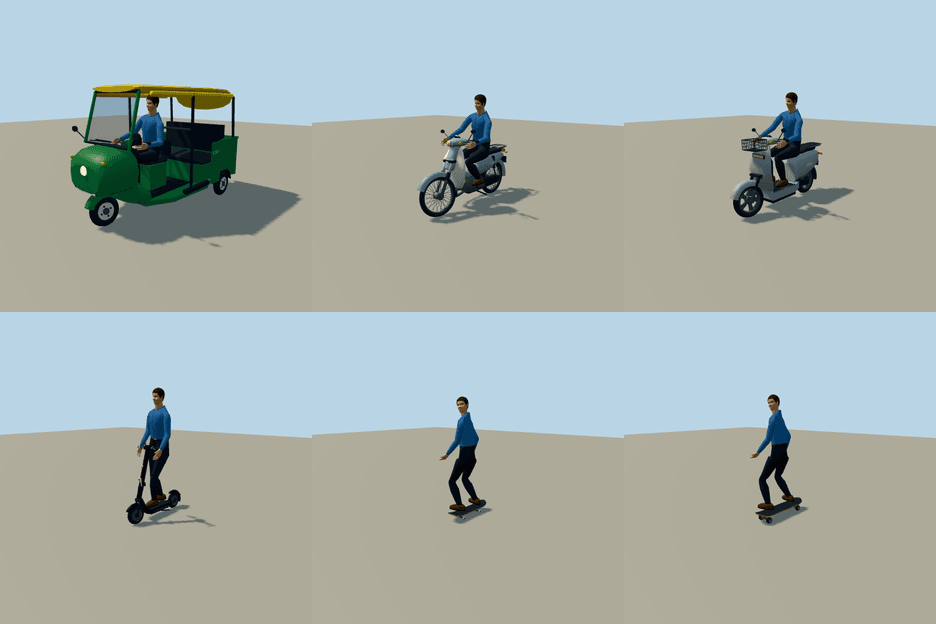

# Light and regional vehicles

This batch adds six original, generic vehicles so that streets around the world carry what people
actually ride: an auto-rickshaw, an underbone moped, an electric moped, a shared electric kick
scooter, a push skateboard and an electric skateboard. All are drivable, and regional fleets park
them, and send the motorized ones through traffic with their riders, where they are common.



| Type id | Name | Class | Size (L × W × H, wheelbase) | Rider |
| --- | --- | --- | --- | --- |
| `molen.entities.vehicle.auto_rickshaw` | Bendy Auto | Auto-rickshaw | 2.63 × 1.30 × 1.76 m, 2.0 m, 1.15 m rear track | Driver on a saddle with handlebars; two passengers |
| `molen.entities.cycle.underbone_moped` | Bendy Moped | Underbone moped | 1.92 × 0.70 × 1.08 m, 1.24 m, 17-inch wheels | Seated |
| `molen.entities.cycle.electric_moped` | Bendy E-Moped | Electric moped | 1.90 × 0.68 × 1.12 m, 1.30 m, 12-inch wheels | Seated, feet on the floor |
| `molen.entities.cycle.kick_scooter` | Bendy Share Scooter | Electric kick scooter | 1.20 × 0.55 × 1.20 m, 0.88 m, 10-inch tyres | Standing |
| `molen.entities.cycle.skateboard` | Bendy Skateboard | Skateboard | 0.80 × 0.21 × 0.15 m, 0.36 m, 53 mm wheels | Sideways, push-powered |
| `molen.entities.cycle.electric_skateboard` | Bendy E-Board | Electric skateboard | 0.97 × 0.25 × 0.17 m, 0.66 m, 90 mm wheels | Sideways |

Dimensions follow the common machines of each class (the rear-engined passenger three-wheeler,
the 100–125 cc step-through, the battery scooter, the dockless shared scooter, a popsicle deck and
a belt-drive board). The geometry is original and generic: no maker's styling, name or emblem. The
kick scooter's liveries follow privately owned scooters, not any sharing operator's colours, and its stem plate reads only `BENDY`; the
auto-rickshaw's plates read `MLN 3W`. Each bundle's README records its parts.

## Construction

`packages/entities/scripts/light-vehicles.mjs` builds the six from the tools of the cycle branch
of `fleet-geometry.mjs` (lofts, tubes, steered fork and bar frames, cycle wheels and lamps) and
gives each a frame that `cycleGeometry()` reads, so the rider contacts in each bundle's
`entity.types.json` (seat, eye, grips, footrests) and the geometry come from one place. A frame may
place its feet one ahead of the other (`footrests`) and its free hands independently (`grips`);
the six existing cycles do not, and every existing fleet model regenerates byte-identical
(`generate-fleet.mjs --check`, all 143).

The auto-rickshaw is a road vehicle on the car solver: three wheel nodes, the front one steered
through a leading-link fork, a nose cowl, windscreen, canvas canopy with rolled side curtains,
open sides, a driver's saddle, a three-seat rear bench and a rear engine. Its `headlights` and
`wipers` actuators drive a lit lens and a wiper arm sweeping in the windscreen's plane. In the
Earth view and World Explorer the headlight switch also lights a real beam from the nose lamp
(`spec.headlamps`); the mopeds, kick scooter and existing motorcycles and scooter name their single
lamp the same way, and the boards name none. The boards
steer through their trucks: `truck-front` and `truck-rear` turn against each other by half the
steering angle, and their wheels spin inside them.

Source GLBs are 3,800–9,200 imported triangles each, with flat PBR materials and no textures.
Each type has two liveries whose paints were studied from linked Wikimedia Commons photographs
([source/liveries.json](source/liveries.json); the auto-rickshaw's canopy is its own paint slot):
Delhi CNG green and Mumbai black for the auto-rickshaw, privately owned black and graphite
scooters for the kick scooter, so it carries no sharing operator's colours.

## Riding

`vehicle.spec.cycle.stance` places the rider: `seated` (the mopeds), `standing` on the deck (the
kick scooter) or `sideways` across the board, left foot forward (the skateboards). Upright riders
stand on the idle pose, and their hips move to each body's own leg length, so riders from 1.55 m
to 1.9 m keep their feet on the deck and hands on the grips. `cycle.kick` makes the skateboard
push-powered: under power the rider turns forward and pushes off the ground with the rear foot,
once per 2.2 m. `vehicle.spec.handlebar` gives the auto-rickshaw's driver the same hand and foot
contacts without cycle balance. See the vehicle guide's
[riding section](../../docs-src/guide/vehicles.md#riding-cycles).

In World Explorer, P on foot sets a personal ride down a step ahead (skateboard, electric board,
kick scooter in turn). The Earth view example's ride menu lists all six.

## Regional mixing

[fleets/road.json](fleets/road.json) binds five more atlas regions and weights the new types:

| Profile | Regions | Two- and three-wheelers (relative weight) |
| --- | --- | --- |
| `south-asia` | India, Pakistan, Bangladesh, Sri Lanka, Nepal | auto-rickshaw 18, motorcycle 16, scooter 14, moped 8, e-moped 4 |
| `southeast-asia` | Thailand, Vietnam, Cambodia, Laos, Myanmar | moped 22, scooter 14, e-moped 6, motorcycle 5, auto-rickshaw 5 |
| `southeast-asia-maritime` | Indonesia, Malaysia, Singapore, Brunei | moped 24, scooter 18, auto-rickshaw 1 |
| `philippines` | Philippines | moped 18, scooter 9 |
| `taiwan` | Taiwan | scooter 26, e-moped 12, moped 2 |
| `china` | China | e-moped 12, scooter 3, moped 2 |
| `europe`, `europe-west` | Continental Europe | scooter 3–4, e-moped 2 |
| `south-america`, `andes` | South America | motorcycle 7, moped 3; auto-rickshaw 4 in the Andes |
| `africa` and its subregions | Africa | motorcycle 8–16, moped 3; auto-rickshaw 6–9 in the north, west and east |

As with the cars, these weights are visual approximations, not registration statistics, and the
generic models stand in for each region's many local makes. The motorcycle, scooter, both mopeds
and the auto-rickshaw carry an `ambientRole` of weight 0, so they never appear in default traffic
or parking. Parked, two-wheelers stand two or three to a car's bay and the auto-rickshaw takes one;
both draw with their own distant silhouettes. In traffic their drivers ride on the saddle and the
two-wheelers lean into turns. Bicycles, kick scooters and boards are never parked or in traffic.

## Verification

- All six source GLBs generate, import with `molen asset import`, and pass the fleet model
  contracts (wheel and spin pivots, budgets, finite bounds), animation coverage and interior
  profile coverage. Rider-view reference photographs were not checked: each is recorded as an
  open gap in `source/interior-references.json`.
- Model sheets (`model-sheet.mjs`) were inspected from the quarter, side, front, rear and top, and
  in clay; riders were rendered stopped, at steering lock, coasting and mid-push from four sides.
- Unit tests cover rider contacts for every stance and three body heights, the push phase,
  handlebar drivers, schema validation of the new fields, parking rows, the two- and
  three-wheeler silhouettes, traffic riders, and the regional profiles (Delhi, Bangkok, Jakarta,
  Manila and Taipei among the resolved cities).
- Car parking placements are unchanged: the pinned placement digest still holds once the
  region-only auto-rickshaw is left out of the default list, as hosts do.
- Livery comparison sheets for the six were captured into `livery-previews/` and the livery
  gallery and catalog guides regenerated.
- In-app: World Explorer was built and played at New Delhi (Connaught Place) in human mode.
  Its status line reported up to 300 parked vehicles across 1,076 bays, but on the headless
  software rasterizer the street tiles timed out before traffic spawned, and no captured frame
  shows the parked rows. Parked rows and traffic riders still need a look in a real browser.

Not yet done: the asset lock. `pnpm assets:build --update-lock` reruns the one `entities-fleet`
generator (all fleet models; the existing ones byte-identical) and imports the six new models;
until then `pnpm assets:check` reports them as unpinned. Bulk renders stay in ignored `shots/`.

## Reproduce

In the engine repository, after building the packages:

```sh
node packages/entities/scripts/generate-fleet.mjs --ids=auto-rickshaw,underbone-moped,electric-moped,kick-scooter,skateboard,electric-skateboard
node packages/tooling/dist/cli.mjs asset import content/entities/source/cycles/skateboard/models/source.glb --id molen.entities.cycle.skateboard --project content/entities/project.json --force
node packages/entities/scripts/generate-models.mjs
node packages/entities/scripts/model-sheet.mjs --ids=auto-rickshaw,underbone-moped,electric-moped,kick-scooter,skateboard,electric-skateboard
node packages/entities/scripts/capture-cycles.mjs --models
```

Import each new model the same way (the auto-rickshaw's source is under `source/vehicles/`).

## Open

- Riders in traffic share the skinned-figure budget (32 by default) with pedestrians; in dense
  two-wheeler traffic the farthest draw riderless.
- The auto-rickshaw is the South Asian body. Bangkok's tuk-tuk, the Philippine tricycle with a
  sidecar and the Peruvian mototaxi are different machines and stand in only approximately.
- Shared kick scooters are rideable but not yet parked on sidewalks, where cities actually leave
  them.
- The existing standard and cruiser motorcycles and the motor scooter still have no engine sound;
  the moped and the auto-rickshaw do.
