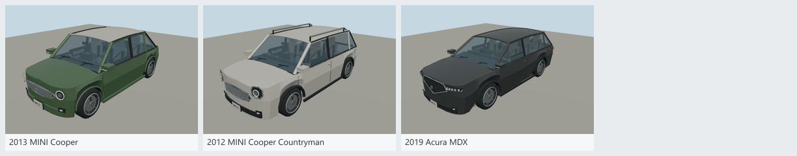
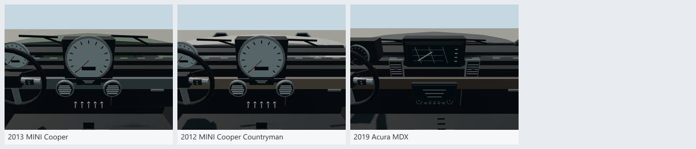

# MINI and Acura vehicles

Two new drivable reference models join the existing 2013 MINI Cooper. The Countryman is white and the MDX is dark gray; these defaults also apply to ambient traffic.

| Model | Paint | ID suffix | Triangles |
| --- | --- | --- | --- |
| 2013 MINI Cooper (existing) | Green, white roof | mini_cooper_2013 | 19,998 |
| [2012 MINI Cooper Countryman](source/vehicles/mini-cooper-countryman-2012/README.md) | White | mini_cooper_countryman_2012 | 22,370 |
| [2019 Acura MDX](source/vehicles/acura-mdx-2019/README.md) | Dark gray | acura_mdx_2019 | 17,814 |

All IDs begin with `molen.entities.vehicle.` and are included in `MOLEN_VEHICLE_ENTITY_IDS` and the main entity helpers. Instantiate their types using the existing Earth vehicle spawn/boarding API. [scenes/mini-acura.scene.json](scenes/mini-acura.scene.json) is the three-model repository showroom. The standard MINI remains part of the forty-model variety collection; it is reused here without a duplicate identity.

The Countryman adds a taller five-door body, roof rails, asymmetric lamp housings and a center dashboard dial. The MDX adds a pentagonal grille, five-element headlights, wraparound tail lamps, three seating rows and stacked center displays. Both wear the collection's neutral chrome badge rather than a maker emblem (see [NOTICE.md](NOTICE.md)). Cabins include seats, belts, door cards, vents and pedals; wheel spin, steering and analog speed needles use live bindings. These are original polygonal interpretations with simplified body surfaces, trim and interiors. Doors remain closed and display graphics are illustrative. Handling is tuned for play.

Dimensions and configurations use [MINI's 2012 specifications](https://www.press.bmwgroup.com/global/article/attachment/T0127716EN/194917) and [Acura's 2019 specifications](https://acuranews.com/en-US/releases/release-b815a17778944b48a636e6f7e33de46e-2019-acura-mdx-specifications-and-features). The requested paint colors are authored approximations, not verified OEM paint codes. No bitmap textures or external meshes are used. The models use existing host distance/proxy policies rather than a separately authored GLB LOD chain.

Validation: 393 entity tests and 136 Earth tests passed, together with the entity build, typecheck and lint. Tests cover registration, source/runtime hashes, triangle budgets, ground alignment, camera placement, requested paint materials and ambient palettes, then mounting, acceleration, steering, braking, reversing and exiting. Whole-fleet `generate-fleet.mjs --check` passed with byte-identical outputs. Four turntable views, a lit three-quarter view and the exact driver-eye view were inspected for each vehicle. [mini-acura-review.json](mini-acura-review.json) binds that review to source, runtime, recipe and image hashes. Bulk captures remain in ignored `shots/` directories.
