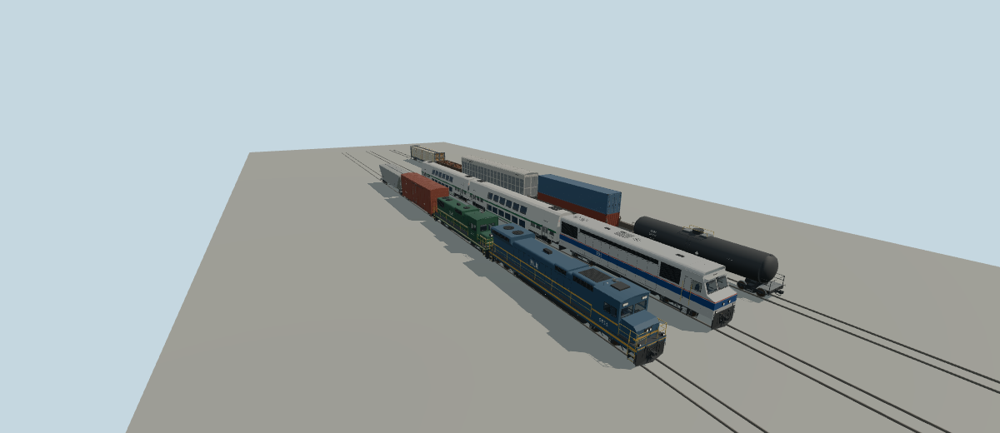

# Rail rolling stock



Twelve North American locomotives, passenger cars and freight cars for track-guided consists.
Each is a deterministic, polygonal interpretation built by one shared generator: no downloaded
meshes, no bitmap textures. Real model names identify what each interpretation depicts; the
geometry and liveries carry no railroad or manufacturer logos, heralds, wordmarks or real
reporting marks. Locomotives letter the fictional `MLN` with a plain number, cars `MLNX`
(see [NOTICE.md](NOTICE.md)). Dimensions are rounded authoring targets from public
specification sheets; running data (mass, tractive effort, power, speeds) is gameplay tuning.

The full ID prefix is `molen.entities.rail.`; `MOLEN_RAIL_ENTITY_IDS` enumerates them, and the
types ship in the pack's `types/rail.types.json`.

| Model | Configuration | ID suffix | Over couplers × width × height | Truck centres | Wheels |
| --- | --- | --- | --- | --- | --- |
| [GE ES44AC](source/rail/ge-es44ac/README.md) | Six-axle AC freight, wide-nose cab, C-C | `ge_es44ac` | 22.3 × 3.12 × 4.72 m | 15.9 m | 42 in |
| [EMD GP38-2](source/rail/emd-gp38-2/README.md) | Four-axle road switcher, low short hood, B-B | `emd_gp38_2` | 18.03 × 3.13 × 4.70 m | 10.36 m | 40 in |
| [MPI MP36PH-3C](source/rail/mpi-mp36ph-3c/README.md) | Commuter cowl unit, cab forward, B-B | `mpi_mp36ph_3c` | 20.6 × 3.2 × 4.75 m | 12.5 m | 40 in |
| [Bombardier BiLevel Coach](source/rail/bombardier-bilevel-coach/README.md) | Commuter coach, two levels plus vestibules | `bombardier_bilevel_coach` | 25.91 × 2.97 × 4.84 m | 18.3 m | 36 in |
| [Bombardier BiLevel Cab Car](source/rail/bombardier-bilevel-cab-car/README.md) | Coach with a front operating cab | `bombardier_bilevel_cab_car` | 25.91 × 2.97 × 4.84 m | 18.3 m | 36 in |
| [50 ft high-cube boxcar](source/rail/boxcar-50ft/README.md) | Plate F, single 10 ft plug door | `boxcar_50ft` | 17.3 × 3.25 × 5.18 m | 12.4 m | 36 in |
| [3-bay covered hopper](source/rail/covered-hopper/README.md) | 5,161 cu ft, trough hatch | `covered_hopper` | 18.0 × 3.2 × 4.6 m | 13.3 m | 36 in |
| [DOT-117 tank car](source/rail/tank-car-dot117/README.md) | Jacketed, about 30,000 gal | `tank_car_dot117` | 18.1 × 3.2 × 4.6 m | 13.4 m | 36 in |
| [53 ft double-stack well car](source/rail/well-car-double-stack/README.md) | Single unit, two 53 ft containers | `well_car_double_stack` | 22.9 × 3.0 × 6.14 m | 19.1 m | 36 in |
| [89 ft enclosed autorack](source/rail/autorack-enclosed/README.md) | Bi-level, perforated sides, end doors | `autorack_enclosed` | 28.0 × 3.25 × 5.94 m | 19.5 m | 36 in |
| [52 ft mill gondola](source/rail/gondola-52ft/README.md) | Fixed ends, scrap load (`load`) | `gondola_52ft` | 17.0 × 3.2 × 2.6 m | 12.7 m | 36 in |
| [73 ft centerbeam flatcar](source/rail/centerbeam-flatcar/README.md) | Wrapped lumber load (`load`) | `centerbeam_flatcar` | 23.3 × 3.2 × 4.6 m | 18.6 m | 36 in |

Corrected from the first brief: the 53 ft well car needs 19.1 m truck centres and 22.9 m over
couplers (not 17.6 m and 21.6 m) so that both trucks clear a 16.2 m well; the gondola's 2.6 m is
the car height, and its scrap load peaks at about 3.0 m.

## Contract

- Front +Z; +X is the vehicle's left (the engineer sits on the right, at -X); y = 0 is the top
  of rail; the origin is on the track centreline midway between the truck centres.
- `truck-front` and `truck-rear` pivot at rail level under each truck centre (hosts swivel them
  on curves). Wheelsets `axle-1` … `axle-n` run front to rear, each a node at its axle centre
  (y = wheel radius) with one child `axle-n-spin` that turns about X. `vehicle.visual.wheelNodes`
  lists every axle; `frontWheelNodes` is `["axle-1"]` (steering is locked).
- `rail-livery-body` takes `vehicle.color`. Second livery colours are `rail-livery-stripe` (and
  `rail-livery-accent` on the MP36PH-3C); running gear is `rail-frame`, `rail-wheel`,
  `rail-steel`. The well car's containers are `container-lower` and `container-upper`; loads use
  `load-scrap`, `load-scrap-steel`, `load-lumber-wrap` and `load-lumber` under the node `load`.
- Locomotive cabs, the cab car's cab and the coach saloon are under `close-detail`. Locomotives
  and the cab car bind `throttle-handle` (rotation about X from `throttle`) and `brake-handle`
  (rotation about Y from `brake`).
- Every `vehicle.spec` carries `rail: { truckCenters, couplerLength, power, gauge: 1.435 }`;
  `wheelbase` equals the truck centres, `engineForce` is the starting tractive effort (1 N on
  unpowered cars) and `power` the power at the rail (0 on cars). Freight cars have no
  `mountable`. Locomotives seat a `driver` at `driverEye` and a `conductor`, boarding at the
  front corner steps or cab doors; the coaches seat passengers at seated eye height on both
  levels (`upper-left-1`, `lower-right-1`, …, `vestibule`) and board at the four side doors.

## Authoring

In the engine repository:

```sh
node packages/entities/scripts/generate-rail.mjs --ids=ge-es44ac,boxcar-50ft
node packages/tooling/dist/cli.mjs asset import content/entities/source/rail/ge-es44ac/models/source.glb --id molen.entities.rail.ge_es44ac --project content/entities/project.json --force
node packages/entities/scripts/generate-models.mjs
pnpm --filter @bendyline/molen-entities exec vitest run test/rail.test.mjs
node packages/entities/scripts/model-sheet.mjs --ids=ge-es44ac,boxcar-50ft --out=shots/rail-sheets
```

`generate-rail.mjs` (registered in `asset-build.json` as `entities-rail`) reads each bundle's
`models/recipe.json`, builds it with the builders in `rail-freight.mjs`,
`rail-locomotives.mjs` and `rail-passenger.mjs` over the shared parts in `rail-geometry.mjs`
(trucks, wheelsets, couplers and draft gear, ladders, grabs, sill steps, brake gear, lettering),
writes `models/source.glb` and the bundle's `entity.types.json`, and pins the master's hash in
`source.json`. `--out-dir=<dir>` writes review candidates only; `--check` fails on stale output.

Triangle counts (drawn, runtime GLB): ES44AC 24.7k, GP38-2 21.3k, MP36PH-3C 19.2k, BiLevel coach
15.6k, cab car 19.7k, freight cars 9.2k–12.0k.
