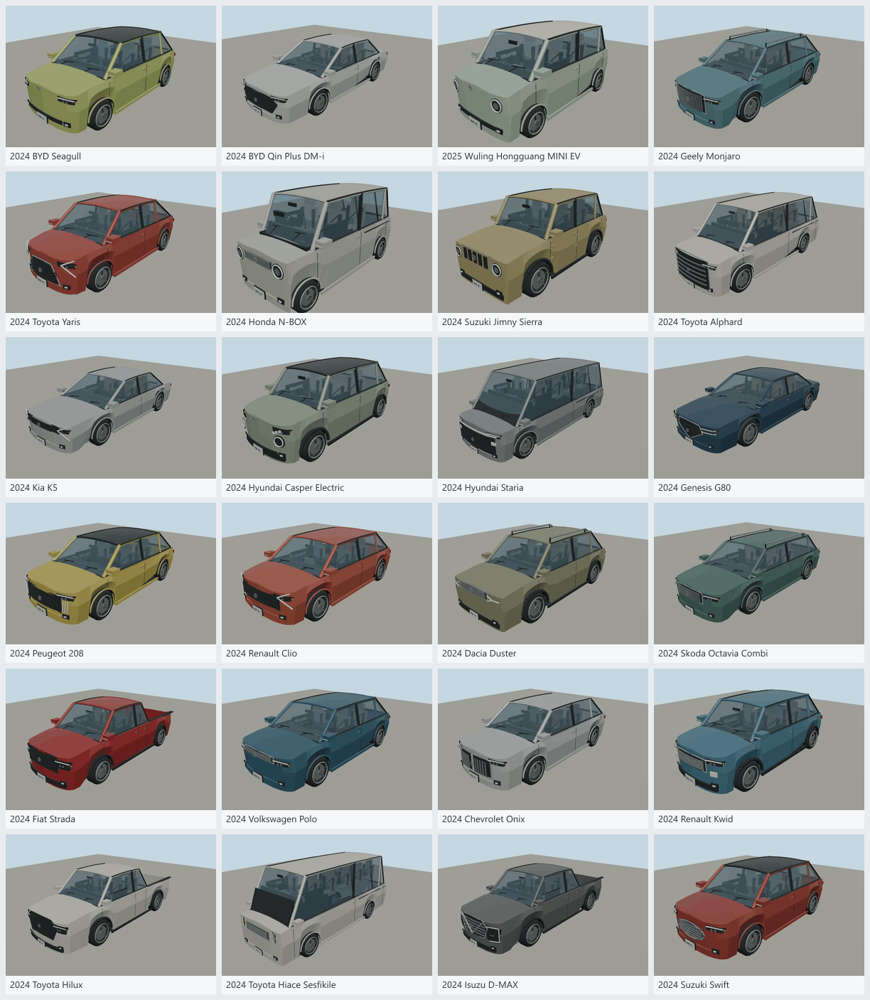
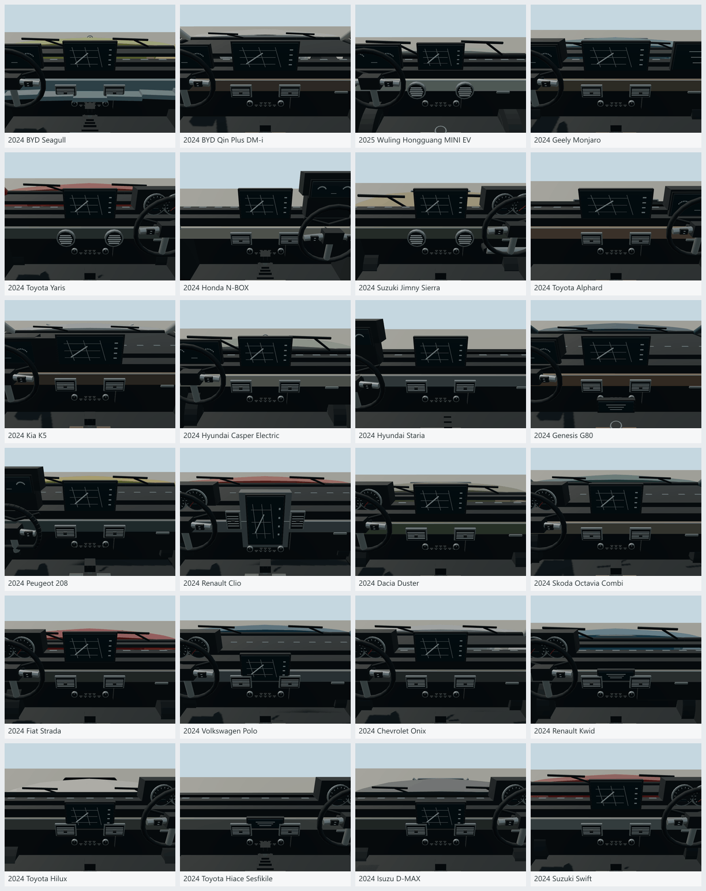

# Regional vehicles and fleets

This batch adds 24 original polygonal reference models: four each for China, Japan, Korea, Europe, South America and Africa. All are drivable, with modeled interiors, correct authored steering-side controls, animated wheels/steering, and a shared palette/material workflow without bitmap textures. The catalog now contains 148 logical entities. Manufacturer, model and year names identify what each interpretation depicts; the geometry carries no maker emblem, wordmark, model lettering or logo-shaped grille — a plain chrome badge and a fictional `MLN` plate stand in. See [NOTICE.md](NOTICE.md).

| Initial market | Model | Inputs |
| --- | --- | --- |
| china | 2024 BYD Seagull | [recipe](source/vehicles/byd-seagull-2024/models/recipe.json) · [source](https://prod.byd.com/en/news-list/The-1-Millionth-BYD-DOLPHIN-MINI-BYD-SEAGULL-Rolled-Off-Production-Line.html) |
| china | 2024 BYD Qin Plus DM-i | [recipe](source/vehicles/byd-qin-plus-2024/models/recipe.json) · [source](https://www.byd.com/en-sa/car/qin-plus-dmi) |
| china | 2025 Wuling Hongguang MINI EV | [recipe](source/vehicles/wuling-hongguang-mini-ev-2025/models/recipe.json) · [source](https://www.gm.com.cn/zh/home/newsroom.detail.html/Pages/news/cn/zh/2024/dec/1210-wuling.html) |
| china | 2024 Geely Monjaro | [recipe](source/vehicles/geely-monjaro-2024/models/recipe.json) · [source](https://www.geely.com/en/models/monjaro) |
| japan | 2024 Toyota Yaris | [recipe](source/vehicles/toyota-yaris-2024/models/recipe.json) · [source](https://global.toyota/en/mobility/toyota-brand/gallery/yaris.html) |
| japan | 2024 Honda N-BOX | [recipe](source/vehicles/honda-n-box-2024/models/recipe.json) · [source](https://global.honda/en/design/project/2024nbox/) |
| japan | 2024 Suzuki Jimny Sierra | [recipe](source/vehicles/suzuki-jimny-sierra-2024/models/recipe.json) · [source](https://www.globalsuzuki.com/globalnews/2021/0120.html) |
| japan | 2024 Toyota Alphard | [recipe](source/vehicles/toyota-alphard-2024/models/recipe.json) · [source](https://global.toyota/en/mobility/toyota-brand/toyota-design/alphard-vellfire/) |
| korea | 2024 Kia K5 | [recipe](source/vehicles/kia-k5-2024/models/recipe.json) · [source](https://www.kiamedia.com/us/en/models/k5/2024/specifications) |
| korea | 2024 Hyundai Casper Electric | [recipe](source/vehicles/hyundai-casper-electric-2024/models/recipe.json) · [source](https://www.hyundai.com/kr/ko/brand/brandstory/heritage/2024-casper-ev) |
| korea | 2024 Hyundai Staria | [recipe](source/vehicles/hyundai-staria-2024/models/recipe.json) · [source](https://www.hyundai.news/eu/articles/press-releases/hyundai-motors-staria-mpv-debuts.html) |
| korea | 2024 Genesis G80 | [recipe](source/vehicles/genesis-g80-2024/models/recipe.json) · [source](https://www.genesis.com/worldwide/en/models/luxury-sedan-genesis/g80/specs.html?seq=0000000618) |
| europe | 2024 Peugeot 208 | [recipe](source/vehicles/peugeot-208-2024/models/recipe.json) · [source](https://www.media.stellantis.com/em-en/peugeot/press/new-peugeot-e-208-irresistible-and-fun-to-drive) |
| europe | 2024 Renault Clio | [recipe](source/vehicles/renault-clio-2024/models/recipe.json) · [source](https://be.media.renaultgroup.com/nouvelle-renault-clio-la-reference-des-citadines-polyvalentes-inaugure-un-nouveau-style/?lang=bel) |
| europe | 2024 Dacia Duster | [recipe](source/vehicles/dacia-duster-2024/models/recipe.json) · [source](https://media.dacia.com/more-duster-still-duster-2/?lang=eng) |
| europe | 2024 Skoda Octavia Combi | [recipe](source/vehicles/skoda-octavia-combi-2024/models/recipe.json) · [source](https://www.skoda-storyboard.com/en/press-kits/skoda-octavia-media-launch-press-kit/exterior-visual-fine-tuning-as-well-as-advanced-headlight-design-and-technology/) |
| south-america | 2024 Fiat Strada | [recipe](source/vehicles/fiat-strada-2024/models/recipe.json) · [source](https://www.media.stellantis.com/br-pt/fiat/fiat-strada-my-2024) |
| south-america | 2024 Volkswagen Polo | [recipe](source/vehicles/volkswagen-polo-2024/models/recipe.json) · [source](https://newsroom-br.itd.vw.com.br/news/2309) |
| south-america | 2024 Chevrolet Onix | [recipe](source/vehicles/chevrolet-onix-2024/models/recipe.json) · [source](https://www.chevrolet.com.br/content/dam/chevrolet/south-america/brazil/portuguese/index/portable-navigation/global-footer/lista-de-precos/lista-de-precos-publicos-sugeridos-novembro.pdf) |
| south-america | 2024 Renault Kwid | [recipe](source/vehicles/renault-kwid-2024/models/recipe.json) · [source](https://cdn.group.renault.com/ren/br/renault-new-cars/editorial/2024/catalogos/kwid/AF_RMA000724_Catalogo_Janeiro_Kwid.pdf.asset.pdf/15f0b3332e.pdf) |
| africa | 2024 Toyota Hilux | [recipe](source/vehicles/toyota-hilux-2024/models/recipe.json) · [source](https://www.toyota.co.za/ranges/hilux) |
| africa | 2024 Toyota Hiace Sesfikile | [recipe](source/vehicles/toyota-hiace-2024/models/recipe.json) · [source](https://www.toyota.co.za/ranges/hiace-sesfikile) |
| africa | 2024 Isuzu D-MAX | [recipe](source/vehicles/isuzu-d-max-2024/models/recipe.json) · [source](https://www.isuzu.co.za/newsroom/isuzu-unveils-the-all-new-isuzu-d-max-x-rider) |
| africa | 2024 Suzuki Swift | [recipe](source/vehicles/suzuki-swift-2024/models/recipe.json) · [source](https://www.globalsuzuki.com/globalnews/2023/1206.html) |

## Regional mixing

[fleets/road.json](fleets/road.json) holds relative visual weights, inheritance and atlas bindings. These are deliberately approximate and are not claimed sales shares. Existing older vehicles remain available, and imported models share IDs across regions. The shortlist defaults to 16 model types per market. The four new core models lead each primary profile, while subregional profiles vary their weights. Generic fallback vehicles retain Bendy names; reference models use their manufacturer/model identity. Aircraft and ships remain global.

The atlas's Korean peninsula region uses a predominantly South Korean fleet. Export trim and steering-side reuse are approximations, especially for shared older cars and Africa's different traffic conventions. Driving side is a separate host setting. Coverage is a starting library, not a comprehensive reconstruction of each country's vehicle stock.

## Streaming and memory

The browser index serves loose, versioned entity files so a no-Range host cannot force a fleet-wide archive download. Only nearby full models load; distant traffic and parking remain instanced proxies. A directory pack keeps at most 16 MiB of cached bytes by default. Ambient road and boat detail pools each default to 32 MiB estimated model buffers, four idle instances and two concurrent loads, with least-recently-used idle eviction. Parking uses at most eight near models and two background loads; inactive borrowed-car geometry unloads while its small simulation state remains. The mounted car and explicit host-owned vehicles are retained. See [the runtime guide](../../docs-src/guide/regional-fleets.md) for configuration and limits.

## Verification

[regional-vehicles-review.json](regional-vehicles-review.json) binds each reviewed source, recipe, type definition, imported model and six local render files by hash. All 24 models passed import inspection and the control loop (mount, accelerate, steer, brake, reverse, stop and exit), model budgets and pivot checks. All four exterior angles, lit views and driver views were inspected. The regional additions are opt-in, and whole-fleet reproducibility passed for the reviewed generator hashes without changing previous model bytes. Concurrent later edits to the shared generators require regeneration and renewed review; the recorded hashes identify the reviewed revision.

Source GLBs contain roughly 15,000–20,000 triangles; the runtime importer merges/optimizes them. Body dimensions, trim, seat layout, display graphics and handling are simplified interpretations. There are no downloaded manufacturer meshes or photorealistic textures. Bulk render files stay in ignored shots/; these two contact sheets are the retained previews.

Regenerate just this batch with the slugs in [source/regional-vehicles.json](source/regional-vehicles.json): `node packages/entities/scripts/generate-fleet.mjs --ids=slug,slug`. Import through `molen asset import`, verify with `asset inspect --verify`, refresh metadata with `node packages/entities/scripts/generate-models.mjs`, and capture with `node packages/entities/scripts/capture-fleet.mjs --ids=slug,slug`.
