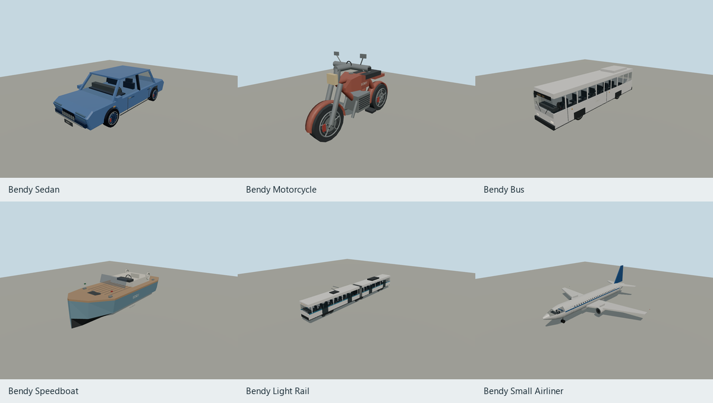
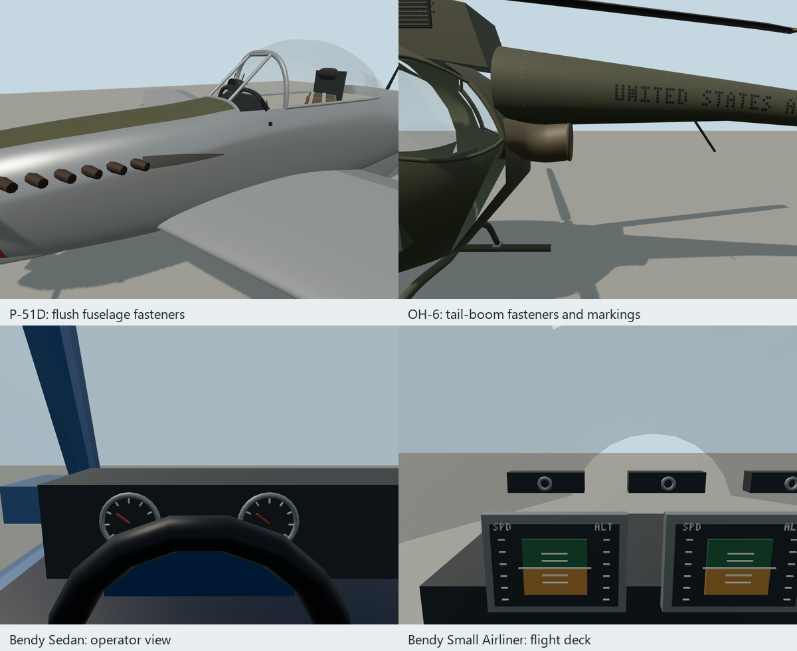

# Bendy vehicle fidelity review — 2026-10-20

This batch improves all 30 existing transport models: 28 generic Bendy vehicles plus the
P-51D Mustang and OH-6. Stable asset/type IDs remain compatible with existing scenes.
The 2024 Ford Mustang is a future reference model, not part of this batch.



Complete contact sheets from the current captures: [road vehicles](bendy-vehicles-preview.png), [cabins](bendy-vehicle-interiors-preview.png), [cycles](cycles-preview.png), [watercraft](watercraft-preview.png), [transit](transit-preview.png), [aircraft](aircraft-preview.png); each source bundle also carries a `preview.png`.

## Changes

- Road vehicles: wheel rims, lug hardware, brake discs and stationary calipers, grilles,
  plates, Bendy lettering, handles, panel gaps, repeaters, exhaust outlets and furnished
  dashboards. Recipe cars now have actual cabin openings, glazing and windshield supports.
  The five original editable car masters are preserved; recipes generate `detailed.glb`.
- Cycles: spokes/hubs, drivetrain detail, brake levers, engine cooling fins, exhaust headers,
  mirrors, fenders, tank caps and better motorcycle tank proportions.
- Boats: chine/keel hull sections, bow sheer, deck fittings, cleats, hatches, navigation
  lamps, life rings, rigging and furnished helms. Large cabin window bands align with
  their declared operator positions.
- Transit: hollow cabins, passenger seats, destination lettering, wipers, cab instruments,
  an animated bus steering wheel and rail traction lever. Rail wheels have steel treads,
  flanges and named spin pivots.
- Aircraft: projected flush fastener rows on the P-51 fuselage and OH-6 tail/cabin skins.
  Existing realistic-aircraft markings, cockpit instruments and mechanical animation remain.
  The Bendy Small Airliner gains cockpit glazing, individual windows, conforming door
  outlines, fuselage fasteners, intake/fan detail, lights, house lettering and flight controls.
  Its flaps follow the wing trailing edge.

All additions use polygonal geometry and restrained materials. No photograph, bitmap
texture or baked lighting is introduced. Repeated details are merged by material; wheel
fittings rotate with the first-child spin node while calipers remain on the steering pivot.



## Controls and distance behavior

All transport types have `vehicle`, `boat` or `aircraft` controls. The bus, light rail and
small airliner now also expose boarding and exit points, operator views and controls.
World Explorer provides Bendy Bus / Bendy Light Rail buttons and a Bendy Small Airliner
visit button. Its practice runway is 1,800 m long; the airliner starts near its south end.

The player light rail uses a straight practice track with locked steering, throttle,
braking and reverse. It does not implement player route selection or curved network
following; those remain ambient-traffic capabilities. The airliner uses the existing
assisted airplane solver with two engines, not a turbofan systems simulation.

The new Bendy dial faces and flight displays are decorative; the HUD supplies live readings.
Steering wheels, helms, yoke, fans, wheels, gear and flaps use named animation bindings.
P-51/OH-6 fastener rows are structural approximations rather than certified rivet maps.
The Mustang's filled wing treatment is retained without a new uniform rivet grid.

Ambient traffic retains its existing distance proxies. The near GLBs do not install a new
universal intermediate vehicle LOD system. Adding controllable transit does not add buses or
rail vehicles to the ordinary curbside parking pool.

## Evidence

[vehicle-review.json](vehicle-review.json) pins every source and imported model hash, mesh,
material, triangle and byte count, render statistics, and exterior/operator cameras.
Final imported budgets:

| Category | Triangles per model |
| --- | ---: |
| Cars and truck | 6,064–6,240 |
| Bicycles | 3,192–3,232 |
| Motorcycles and scooter | 7,096–7,120 |
| Boats and ships | 4,848–5,420 |
| Bendy Bus / Light Rail | 7,016 / 6,492 |
| Bendy Small Airliner | 30,814 |
| OH-6 / P-51D Mustang | 33,390 / 47,626 |

Each model was rendered from four turntable angles, a three-quarter view and its declared
operator eye. Aircraft also have skin-detail captures. Inspection caught and corrected
submerged dashboards, solid transit interiors, floating wipers, detached airliner flaps,
buried door outlines and missing windshield supports. Bulk images remain local in each
source bundle's ignored `shots/`; only the two summary previews above are retained here.

Reproduction commands from the repository root:

```sh
node packages/entities/scripts/generate-fleet.mjs --check
node packages/entities/scripts/generate-models.mjs --check
node packages/entities/scripts/capture-fleet.mjs
node packages/entities/scripts/preview-fleet.mjs
node packages/tooling/dist/cli.mjs play examples/world-explorer/dist --scenario examples/world-explorer/test/visual/bendy-transit.play.json --out-dir .artifacts/bendy/play
```

All 25 recipe models reproduce byte-for-byte. All five standalone generators were also
run with `--out` into separate candidate GLBs and compared against their source pins.
All 30 imported assets pass hash verification. No global asset stamp was synthesized.

Validation completed: entities 124 tests, Earth 136 tests, schema 169 tests, World Explorer
37 tests; affected package type checks; the built browser boarding/control scenario;
packed-install smoke (17 package tarballs / seven templates); schema-doc and docs-site checks;
the full golden suite (55 passed, ten WebGPU-dependent tests skipped on this host).
Golden packs used the supported `MOLEN_PACK_COMPRESSION=store` local-build option.
The simulation test boards the airliner from ground level and takes off within the runway.

Repository-wide `verify` stops at the stale installed-asset input stamp, which includes this
batch and other local model edits. A separate source check reports an unrelated missing
manifest entry for `medium-fi-report.json` in the SoFi Stadium source bundle. Earlier broad
builds also encountered the changing worldgen structure index; the subsequent docs-site build
completed. These external model changes were left intact.

The close-view policy is in [the medium-fi guide](../../docs-src/guide/medium-fi.md#controllable-vehicles-close-view-fidelity).
Real-aircraft reference context remains in the [P-51](source/aircraft/p-51/REFERENCES.md) and
[OH-6](source/aircraft/oh-6/REFERENCES.md) bundles; their older verification files are explicitly
marked historical.
