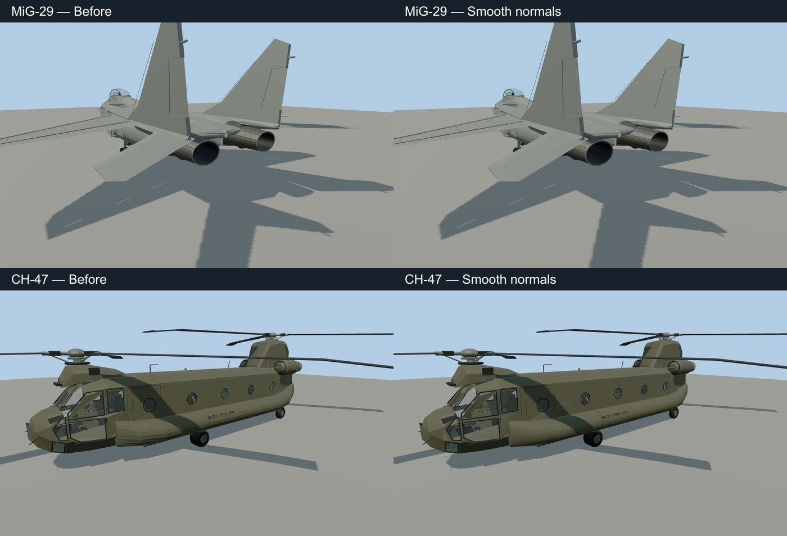

# Curved surface shading review — 2026-10-25

The MiG-29 engines and CH-47 sponsons now shade continuously around their existing contours.
The fix preserves vertex normals during batching/degenerate-triangle cleanup and smooths
individual round lofts before their caps and neighboring parts are assembled. It does not
increase radial segment counts, add textures, or require a runtime smoothing pass.

## Scope and decisions

- Audited all 1,262 registered models in the entities and worldgen projects: 198 entity models
  and 1,064 structures. Inspected 64 overview contact sheets plus matching MiG-29 rear/nose,
  CH-47 sponson closeups, and the affected structure sheet. These are catalog-scale reviews,
  not a complete closeup/turntable review of every small part.
- Applied the shared fix to the expansion aircraft and generic airliner. Dense round lofts
  default to smooth shading; sparse polygonal contours remain faceted. Authors can explicitly
  set `smooth: false`. A 40-degree crease threshold keeps corners hard, with caps separate.
- Preserved existing normals on wheels, tires, axles, spheres, boxes and authored panels.
  The 123 road vehicles, six cycles, eight boats, two transit models and six nature models
  reproduce their original runtime GLBs byte for byte after the final pass.
- Smoothed selected surfaces on 16 provisional structures: A05, A07, A13, A14, A17, A18,
  A19, B05, B07, B16, E01, E02, E03, E08, E11 and E14. Their 32-degree crease limit retains
  caps, rim boundaries, columns and building corners. Refreshed their four runtime LODs.
  The structure generator supports selecting IDs and avoids rewriting identical files,
  preventing the unnecessary metadata writes that hit Windows file-access errors in this run.
- Retained deliberately polygonal architecture, masonry, roof panels, ornamental ribs,
  rock and vegetation forms. Normal smoothing cannot remove a polygonal silhouette; the
  inspected aircraft curves did not require extra segments at the reviewed viewing distances.

## Budget

Smoothing itself changes normals only: triangle positions, winding, UVs and counts are retained.
It shares materials rather than adding a separate material/draw call for each curved part.
The 16 structure meshes retain all triangle and material counts and save 66,928 runtime bytes.

The aircraft regeneration also includes cockpit/control/texture changes already present in
the working tree when this review began. Consequently its total delta is not an isolated
measurement of the shading fix: all 53 aircraft together changed from 3,229,015 to 3,239,475
triangles while their optimized vertices fell from 6,648,962 to 4,821,501 and their combined
runtime size fell from 130,607,236 to 124,208,292 bytes. No cockpit recipe, texture, livery,
or triangle-budget limit was changed for this shading work.

## Validation and local evidence

- `surface-normals.test.mjs` and `aircraft-joins.test.mjs`: 14 tests pass, including radial
  normals across unequal loft lengths, cap/box creases, explicit flat contours, unchanged
  geometry/UVs, shared material identity and deterministic normal arrays.
- Binary audit of all 1,262 runtime models: no missing/invalid normals or hash mismatches.
- Source/runtime hashes verified for all 69 changed assets; all non-aircraft triangle,
  mesh and material counts are unchanged.
- `generate-fleet.mjs --check`: deterministic reproduction passes for all fleet recipes.
- `generate-structure-catalog.mjs --check`: all 97 generated structure sources pass.
- `import-structure-catalog.mjs --index-only`: 97 runtime structure assets verified and
  aggregate catalog refreshed.
- `generate-liveries.mjs --check`: 198 source bundles and 385 liveries for 192 vehicles pass
  catalog/name validation. This does not replace the runtime livery test below.
- Biome checks pass for the eight implementation/test files changed for shading.

The batch source build completed the affected generators and imported all 69 changed models.
Its full structure LOD sweep passed 1,063 of 1,064 models; the Istanbul Sapphire subprocess
failed once resolving the local compiled kernel dependency (`ERR_MODULE_NOT_FOUND`). A
targeted retry passed. The combined result verifies all 1,064 LOD sets and confirms their
final asset metadata matches the validated output. The batch command itself retained a
nonzero exit status from the original failed attempt; it is not reported as a green full build.

The complete entity test run reports **865 passed, 15 failed**. Eleven tests use the browser
GLTF loader in Node and fail on `self` when loading the newly embedded cockpit textures;
two Huey tests find no surfaces under their old panel material names; the Cessna 172 has
15 textures against a 12-texture assertion; and the P-51 livery test has stale cockpit
paint-slot/material matches. These remain unresolved in the current working tree. The
shading work does not relax these tests or change cockpit/livery behavior to hide them.

Bulk images and detailed evidence remain local under `.artifacts/curve-review/`:
`before.json`, `audit.json`, `final-verified.json`, `budget.json`, `gallery/`,
`world-overview/`, `world-changed/`, `normal-tests-final.log`, `entity-tests-final.log`,
`fleet-repro-final.log`, `structure-check-final.log`, `livery-check-final.log`, `lods.log`,
`batch-build-final.log`, `lod-retry.log` and `lod-validation.json`.
No screenshots were published and no review lock was updated.
