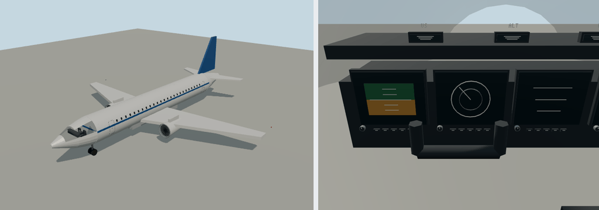

# Bendy Small Airliner



Portable source bundle for `molen.entities.aircraft.airliner`, a 38 m twin-jet for ambient air
traffic and player flight. Select **Bendy Small Airliner** in the World Explorer to visit its
boarding point. The `aircraft` component supplies two engines, pitch/roll/yaw, throttle,
gear and flaps. The existing assisted airplane model approximates thrust; it is not a
turbofan systems simulator. `ambientRole` retains its overhead and airport traffic roles.

- Model generator: `models/generate.mjs` (deterministic, no textures; preserves hand edits of
  `models/source.glb`; `--out <path>` writes a review candidate).
- Editable model: `models/source.glb`
- Entity definition: `entity.types.json`
- Imported output: `assets/molen/entities/aircraft/airliner/asset.json`

## Brief

- Silhouette: cylindrical fuselage with nose and tail cones, low swept wings with two
  under-wing engines, swept tailplanes and a tall fin in the livery colour.
- Dimensions: approximately 39 m long, 35.8 m span and 12.2 m tall with gear down. The origin
  is at ground level and the nose faces +Z.
- Animated nodes: `fan-left`, `fan-right` (spin about Z); `gear-nose`, `gear-left`, `gear-right`
  (animated by gear selection), `flap-left`, `flap-right` and `control-yoke`.
- Paint: `airliner-livery` (fin and cheatline) takes the agent colour.
- Close detail: individual passenger windows, actual cockpit glazing, door outlines,
  intake lips and fan blades, navigation lamps, Bendy lettering and flush fuselage fasteners.
  The flight deck includes seats, yoke, throttle handles and diagrammatic instrument displays;
  live flight readings are in the HUD.
- Budget: 30,814 rendered triangles, no textures. Generic fastener rows suggest structural
  frame stations; they do not reproduce a particular manufacturer's engineering drawing.

## Evidence

In the engine repository, from `content/entities`:

```sh
node source/aircraft/airliner/models/generate.mjs
npx molen asset import source/aircraft/airliner/models/source.glb --id molen.entities.aircraft.airliner --asset-dir assets/molen/entities/aircraft/airliner --project project.json --force
npx molen asset inspect molen.entities.aircraft.airliner --verify --project project.json
```
