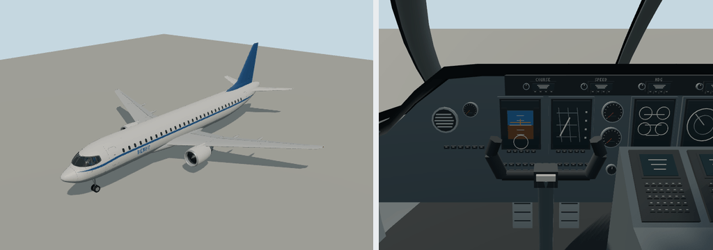

# Bendy Small Airliner



Portable source bundle for `molen.entities.aircraft.airliner`, a 38 m twin-jet for ambient air
traffic and player flight. Select **Bendy Small Airliner** in the World Explorer to visit its
boarding point. The `aircraft` component supplies two engines, pitch/roll/yaw, throttle,
gear and flaps. The existing assisted airplane model approximates thrust; it is not a
turbofan systems simulator. `ambientRole` retains its overhead and airport traffic roles.

- Model generator: `models/generate.mjs` (deterministic, no textures; preserves hand edits of
  `models/source.glb`; `--out <path>` writes a review candidate). It composes
  `packages/entities/scripts/aircraft/transport-kit.mjs` with Bendy's own station tables, drops the
  kit's shared cockpit and fits its own flight deck to the same surface.
- Editable model: `models/source.glb`
- Entity definition: `entity.types.json`
- Imported output: `assets/molen/entities/aircraft/airliner/asset.json`
- Review record: `reference-review.json`

## Brief

- Silhouette: an invented small twinjet. Deep blunt nose with a windscreen break, parallel barrel
  3.9 m across, upswept tail cone, low swept wings with two under-wing engines, swept white
  tailplanes and a tall fin in the livery colour. It claims no real type; a true-scale line-up
  against the 737-800 and A220-300 checks that it reads as the same kind of machine.
- Dimensions: 39 m long, 35.8 m span and 12.2 m tall with gear down. The origin is at ground level
  and the nose faces +Z.
- Animated nodes: `fan-left`, `fan-right` (spin about Z); `gear-nose`, `gear-left`, `gear-right`
  (animated by gear selection); `flap-left`, `flap-right` and their `-inner` pairs;
  `control-yoke`, `control-column` and their `-right` pairs, `pedal-*`, `power-lever-*` and
  `horizon-*`.
- Paint: `airliner-livery` (fin, cheatline and lettering) takes the agent colour.
- Close detail: individual passenger windows, glazed windscreen and side windows with outer
  frames and boxed inner pillars, door outlines, intake lips and fan blades, navigation lamps,
  wipers, pitot masts, Bendy lettering and flush fuselage fasteners.
- Flight deck: two seats, glareshield rising from the windscreen sill, 6 by 8 in displays, 3 1/8 in
  standby dials, mode control panel, control columns, centre pedestal, side consoles and overhead
  panel. Screens are diagrammatic, except a live horizon cue; flight readings are in the HUD.
  The seated eye is 0.75 m from the panel face, with the glareshield about 14 degrees below it.
- Budget: 60,062 rendered triangles, no textures. Generic fastener rows suggest structural frame
  stations; they do not reproduce a particular manufacturer's engineering drawing.

## Evidence

In the engine repository, from `content/entities`:

```sh
node source/aircraft/airliner/models/generate.mjs
npx molen asset import source/aircraft/airliner/models/source.glb --id molen.entities.aircraft.airliner --asset-dir assets/molen/entities/aircraft/airliner --project project.json --force
npx molen asset inspect molen.entities.aircraft.airliner --verify --project project.json
```
