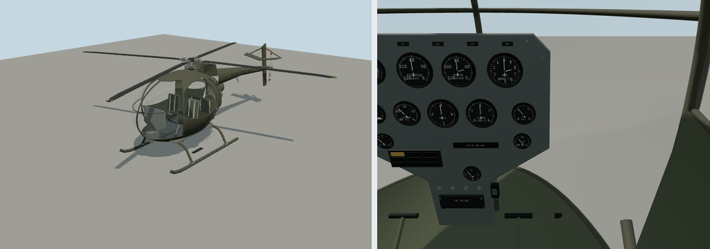

# OH-6



Portable source bundle for `molen.entities.aircraft.oh6`. The entity definition owns all
concrete flight tuning, seats, collision probes, visual bindings, and behavior-script attachment.
Molen supplies the generic `airplane` or `helicopter` solver.

- Editable model: `models/source.glb`
- Model-owned cockpit layout and builder: `models/interior.json`, `models/interior.mjs`
- Instrument/control node names and calibration: `aircraft.spec.visual.interior` in the entity definition
- Model generator: `models/generate.mjs`. It keeps `source.json`'s pin current and will not overwrite a hand-edited `models/source.glb`
- Entity definition: `entity.types.json`
- Behavior: `scripts/interactions.ts`
- Imported output: `assets/molen/entities/aircraft/oh6/asset.json`

The cockpit is part of the main GLB and appears in exterior and seated views. Its layout and
builder can change independently of any other aircraft. Generate an edited preview with
`node models/generate.mjs --out /tmp/oh-6-candidate.glb`; review it before adopting a new master.

In the engine repository, re-import from the repository root with:

```sh
node packages/tooling/dist/cli.mjs asset import content/entities/source/aircraft/oh-6/models/source.glb --id molen.entities.aircraft.oh6 --project content/entities/project.json --force
```

The reference-informed cockpit and exterior pass is documented in [REFERENCES.md](REFERENCES.md).
Instrument parts live in `models/instruments.mjs`. Dial numerals, captions and placards use
Overpass Semibold baked into an antialiased texture atlas, shared by all lettering in the model.
The GLB embeds the atlas; it needs no installed fonts at runtime. The repository helper and
licensed font sources are documented in [cockpit lettering](../../../fonts/README.md).
Cockpit enamel, upholstery and harnesses also use procedural finish textures.

The exterior follows the OH-6A silhouette: an egg-shaped cabin with arched front door windows and
separate rear glazing, a narrow transmission doghouse and louvered intakes, a tapered boom and
braced tail stabilizer, a mechanical four-blade main rotor, a two-blade left-side tail rotor,
curved low skid cross-tubes and a rear-facing exhaust outlet. The cockpit uses a narrow gray
center pedestal with analog flight/engine instruments, dual tubular cyclics and collectives,
exposed seat frames, harnesses and an aft bench. The main rotor radius remains 4.025 m.
