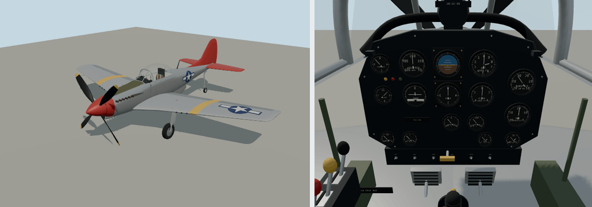

# P-51D Mustang



Portable source bundle for `molen.entities.aircraft.p51d`. The entity definition owns all concrete flight tuning, seats, collision probes, visual bindings, and behavior-script attachment. Molen supplies the generic `airplane` or `helicopter` solver.

- Editable model: `models/source.glb`
- Model-owned cockpit layout and builder: `models/interior.json`, `models/interior.mjs`
- Instrument/control node names and calibration: `aircraft.spec.visual.interior` in the entity definition
- Model generator: `models/generate.mjs`. It keeps `source.json`'s pin current and will not overwrite a hand-edited `models/source.glb`
- Entity definition: `entity.types.json`
- Behavior: `scripts/interactions.ts`
- Imported output: `assets/molen/entities/aircraft/p51d/asset.json`

The airframe is lofted from analytic sections at the real P-51D's size (9.83 m long, 11.28 m
span): a laminar-flow wing with a straight trailing edge, root glove, 5° dihedral and squared tips,
a teardrop canopy behind a three-panel windscreen, the ventral radiator scoop, a dorsal fillet and
a 3.4 m four-blade propeller. It is finished in natural metal with lacquered wings, an olive-drab
anti-glare panel, a red nose, spinner and tail, yellow wing bands and star-and-bar insignia, all as
geometry with no textures. It rests level on its wheels, matching the airplane solver on the
ground; the nose faces +Z and the pilot eye, thrust line and wing reference match the entity
definition. `propeller` spins about Z; `flap±1`, `aileron±1` and `elevator±1` rotate about local X
(each flap and aileron under a `*-hinge` frame on its hinge line) and `rudder` about Y.

The landing gear retracts as the real one does, sequenced by `visual.animation` over the
simulated gear position. The large inner well doors (`wheel-door±1`) open; each main leg
(`gear±1`) swings inboard on a trunnion canted 25° inboard and 20° down from aft, laying its wheel
flat in a well in the wing root ahead of the spar; then the doors close behind it. The strut
fairing door rides on the leg and closes the strut channel flush with the lower wing. The tail
wheel (`tail-gear`) folds forward into the rear fuselage between two pairs of doors: the aft pair
(`tail-door±1`) stands open round the strut while the gear is down, the forward pair
(`tail-bay-door±1`) opens only while the wheel swings through. Lowering runs the same sequence
backwards, and the inner doors close again once the gear is down. The axes and angles were solved
against the generator's own wing and fuselage, so every retracted part sits inside the skin with
a few centimetres to spare. The wells and slot are dark linings just under the skin. `gear±1-leg`
and `tail-gear` hide while the gear is fully up.

A full gear cycle takes 12 seconds and the flaps run to 50° in 13 (`gearTransitTime`,
`flapTransitTime`); secondary sources quote 10–15 and 11–15 seconds from the period pilot's
manuals, which were not checked directly. The gear will not move with weight on the wheels, so
selecting it up early raises it after liftoff; touching down before it locks is a belly landing.
The elevator travels 30° up and 20° down and the rudder 25° each way; those are approximations.

The cockpit is part of the main GLB and appears in exterior and seated views. Its layout and
builder can change independently of any other aircraft. Generate an edited preview with
`node models/generate.mjs --out /tmp/p-51-candidate.glb`; review it before adopting a new master.
In the engine repository, `pnpm assets:build --update-lock` rebuilds the master and its lock. A
direct run that should match those bytes needs the build's portable math:
`node --import=./packages/worldgen/scripts/install-deterministic-math.mjs content/entities/source/aircraft/p-51/models/generate.mjs`
from the repository root.

Flight tuning uses 1,264 kW maximum shaft power, 0.83 propeller efficiency, a 14,500 N static
thrust cap, and a clean drag polar of `0.019 + 0.055 * CL²`. The power is approximately
1,695 hp, the rating listed by the [National Museum of the US Air Force](https://www.nationalmuseum.af.mil/Visit/Museum-Exhibits/Fact-Sheets/Display/Article/196263/north-american-p-51d-mustang/).
The drag/control coefficients are game-model tuning, not a reconstruction of flight-test data.
The full-power, clean, altitude-held regression at 1,000 m reaches about 311 knots after
120 seconds from 60 m/s. Gear/flaps still impose substantial drag, and climbing reduces acceleration.

The shared solver progressively separates wing flow past critical incidence and couples assisted
yaw to actual lift plus sideslip stability. Stall recovery is lower nose, add power, level wings,
then gently pull out after speed returns. See `packages/kernel/test/aircraft-performance.test.ts`
in the repository for the reproducible performance and banked-stall scenarios.

In the engine repository, re-import from the repository root with:

```sh
node packages/tooling/dist/cli.mjs asset import content/entities/source/aircraft/p-51/models/source.glb --id molen.entities.aircraft.p51d --project content/entities/project.json --force
```

The reference-informed cockpit and exterior pass is documented in [REFERENCES.md](REFERENCES.md).
Instrument parts live in `models/instruments.mjs`. Dial numerals, captions and placards use
Jost Medium baked into an antialiased texture atlas, shared by all lettering in the model.
The GLB embeds the atlas; it needs no installed fonts at runtime. The repository helper and
licensed font sources are documented in [cockpit lettering](../../../fonts/README.md).
Cockpit enamel, upholstery and harnesses also use procedural finish textures.

The lower cockpit has an inward-facing fuselage lining, fitted olive-green side panels,
reinforced canopy channels, trim wheels and right-side equipment. Its floor and dark footboards
clear the wing crown. The 2026-10-27 enclosure correction and pilot-eye review are recorded in
[COCKPIT-REVIEW.json](COCKPIT-REVIEW.json); [cockpit preview](cockpit-preview.png).
The follow-up reference pass narrows the panel crown and gives its silver support long sloping
legs. A clipped two-column "BEFORE TAKE OFF / BEFORE LANDING" card and a cream canopy-release
warning sit above the instruments; their lettering uses the existing period font atlas.
