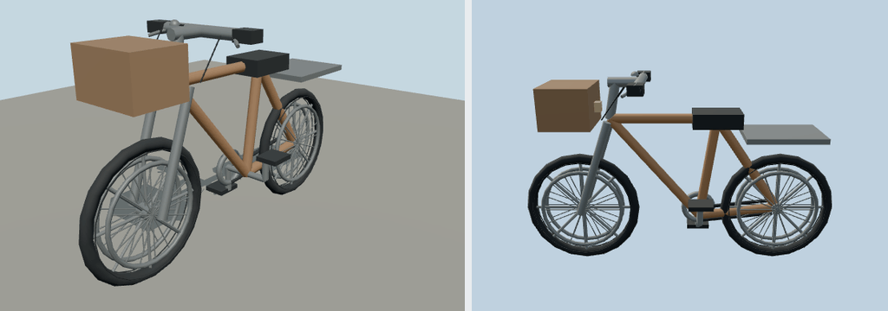

# Bendy City Bicycle

Original brief: add diverse cars, motorcycles, bicycles, boats, cargo ships and ferries to Molen.

Editable recipe: models/recipe.json. Shared engine authoring capability: packages/entities/scripts/fleet-geometry.mjs. Regenerate in the engine repository with `node packages/entities/scripts/generate-fleet.mjs --ids=city-bicycle`. The recipe owns all concrete values; no sibling bundle supplies data.

Dimensions: 1.85 m long × 0.62 m wide × 1.14 m nominal height. +Y up, +Z forward; tires contact Y=0. Bright polygonal medium-fi style, flat PBR colors, no image textures or image-generation prompts. Static pieces merge by material; wheel groups preserve named spin pivots. Convex collision is derived by the importer. Geometry is a stylized generic design, not a licensed make.

Rideable through `installVehicles` and the shared mount/drive/exit API. The driver seat anchors the pelvis; model-space grips and footrests drive the procedural rider pose. The front wheel and handlebars steer, both wheels spin, and bicycle cranks turn only under forward power. Self-balancing handling leans inward in turns and stands upright at rest; falls, wheelies and stunt physics are not simulated.

Inspect the mounted rider in `content/entities/scenes/cycles.scene.json` with `--setup content/entities/scenes/cycles.setup.mjs`. Source/runtime hashes are recorded in `source.json` and the imported `asset.json`; four model views are in `shots/`.
