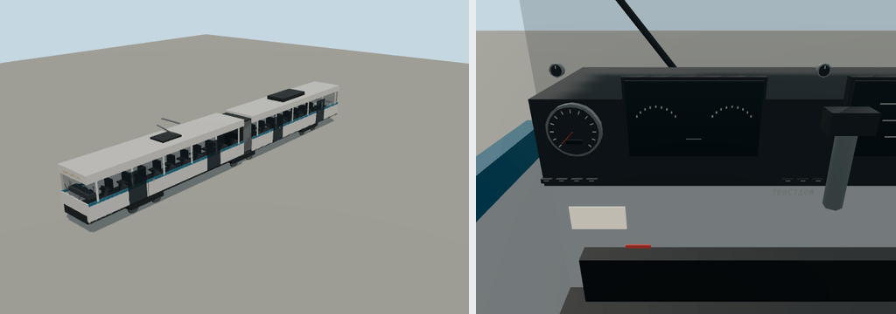

# Bendy Light Rail



Portable source bundle for `molen.entities.transit.lightrail`, a 27 m two-section light-rail
vehicle. Ambient trains run consists of it on mapped rail and tram lines, stopping at stations.
Both ends retain a cab silhouette; the forward cab includes the player controls. Select
**Bendy Light Rail** in the World Explorer for a straight practice track, with throttle,
braking and reverse. Steering is locked to zero. Curved route following remains an ambient
traffic feature; this player controller does not implement a rail network solver.

- Model generator: `models/generate.mjs` (deterministic, no textures; preserves hand edits of
  `models/source.glb`; `--out <path>` writes a review candidate).
- Editable model: `models/source.glb`
- Entity definition: `entity.types.json`
- Imported output: `assets/molen/entities/transit/lightrail/asset.json`

## Brief

- Silhouette: two body sections joined by a dark articulation, continuous window band, livery
  stripe, a pantograph on the front section and three bogies.
- Dimensions: 27.0 m long, 2.65 m wide, 3.6 m body height over a 0.95 m floor; y = 0 is the rail
  head. The origin is centred and the front faces +Z.
- Nodes: `body`, `pantograph`, `bogie-front`, `bogie-middle`, `bogie-rear`, twelve named
  bogie wheel pivots with spin children, and an animated `traction-lever`.
- Paint: `rail-livery-body` takes the agent colour; `rail-livery-stripe` stays teal.
- Close detail: seats, cab panel, glazed doors, destination lettering, wipers, articulation
  ribs, steel wheel treads and flanges.
- Budget: 6,492 rendered triangles, no textures.

## Evidence

In the engine repository, from `content/entities`:

```sh
node source/transit/light-rail-car/models/generate.mjs
npx molen asset import source/transit/light-rail-car/models/source.glb --id molen.entities.transit.lightrail --asset-dir assets/molen/entities/transit/lightrail --project project.json --force
npx molen asset inspect molen.entities.transit.lightrail --verify --project project.json
```
