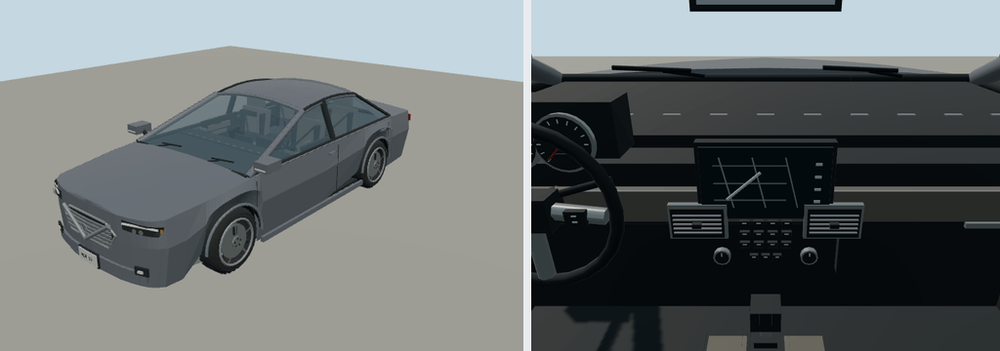

# 2013 Acura TL

3.5 Technology sedan; sedan. Original polygonal reference interpretation for close-view driving.

Rounded authoring envelope: 4.928 × 1.88 × 1.453 m, excluding mirrors and rear spare; wheelbase 2.775 m. Geometry includes actual wheel openings, hollow cabin, seats, controls, mirrors, wipers, lamps and separate wheel/caliper transforms. Model-specific proportions and features are editable in models/recipe.json.

[Reference context](https://acuranews.com/en-US/releases/release-22adbecae4fe4f06b57b2fa679c78e23-2013-acura-tl-press-kit) — manufacturer material, including archived brochures where necessary. Sources establish generation/design context; not every authored dimension or trim detail is independently measured. No downloaded geometry or bitmap textures. Dashboard graphics and handling are simplified for play. 

Generate: node packages/entities/scripts/generate-fleet.mjs --ids=acura-tl-2013. Import the resulting GLB using the source manifest ID. Capture: node packages/entities/scripts/capture-fleet.mjs --ids=acura-tl-2013. The shared generator is packages/entities/scripts/road-vehicle-geometry.mjs. Bulk renders stay in ignored shots/; see content/entities/VARIETY-VEHICLE-REVIEW.md for batch evidence.
