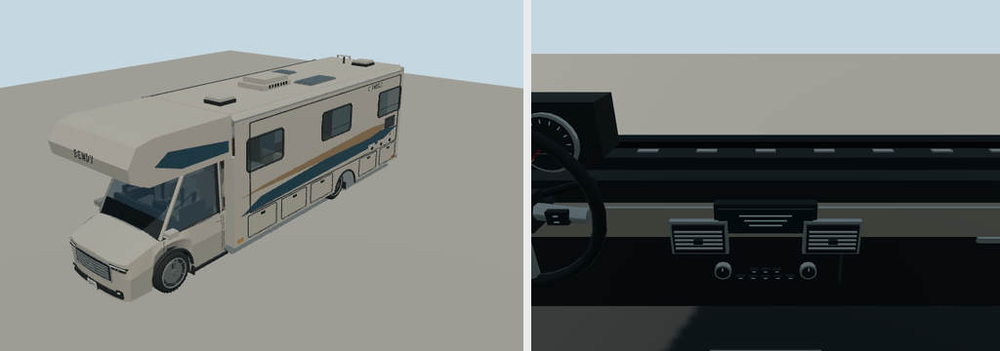

# Bendy Class C Family

Prompt: add about five RVs, covering Class C, A and B, including a 2022 Winnebago View. This six-model batch supplies two Cs, three As and one B.

Original Bendy Class C design; dimensions and fittings are authored design choices.

Metres; +Y up, +Z forward, +X driver side, ground origin. Generated by packages/entities/scripts/rv-geometry.mjs via generate-fleet.mjs. recipe.json is editable input. Near-view target: at most 45,000 triangles; geometry and PBR colors only, no bitmap textures or image-generation prompts. Material batching retains steering, wheel spin and speed-needle pivots. All roof fittings and storage/awning/slideout/door details are stowed and static. Interior is visual dressing; boarding uses the driver mount, not a walkable living-area simulation. Handling is game tuning, not manufacturer performance. RVs use the low-frequency bus-sized road-traffic role, which excludes them from ordinary curbside parking.

Generate: node packages/entities/scripts/generate-fleet.mjs --ids=bendy-class-c-family

Import through molen asset import with --id molen.entities.vehicle.bendy_class_c_family --project content/entities/project.json, then asset inspect --verify. Batch render command and hash-bound review are in content/entities/RV-REVIEW.md.
