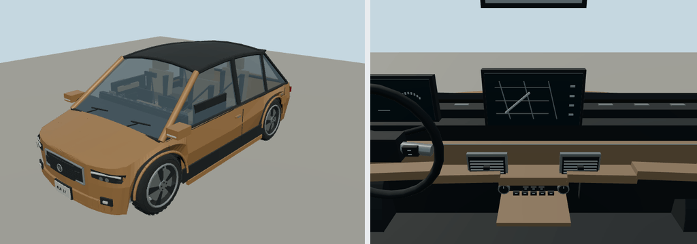

# 2017 BMW i3

94 Ah battery electric; city. Original polygonal reference interpretation for close-view driving.

Rounded authoring envelope: 3.999 × 1.775 × 1.578 m, excluding mirrors and rear spare; wheelbase 2.57 m. Geometry includes actual wheel openings, hollow cabin, seats, controls, mirrors, wipers, lamps and separate wheel/caliper transforms. Model-specific proportions and features are editable in models/recipe.json.

[Reference context](https://www.press.bmwgroup.com/usa/article/detail/T0261023EN_US/model-year-2017-update-information) — manufacturer material, including archived brochures where necessary. Sources establish generation/design context; not every authored dimension or trim detail is independently measured. No downloaded geometry or bitmap textures. Dashboard graphics and handling are simplified for play. 

Generate: node packages/entities/scripts/generate-fleet.mjs --ids=bmw-i3-2017. Import the resulting GLB using the source manifest ID. Capture: node packages/entities/scripts/capture-fleet.mjs --ids=bmw-i3-2017. The shared generator is packages/entities/scripts/road-vehicle-geometry.mjs. Bulk renders stay in ignored shots/; see content/entities/VARIETY-VEHICLE-REVIEW.md for batch evidence.
