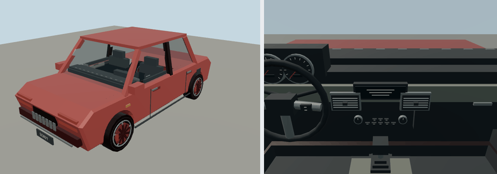

# Bendy Compact

Portable source bundle for `molen.entities.vehicle.compact`. Its definition contains the complete resolved vehicle physics, seats, camera/visual bindings, initial state, and behavior-script attachment; it has no dependency on a separate concrete vehicle preset.

- Editable model: `models/source.glb`
- Entity definition: `entity.types.json`
- Behavior: `scripts/interactions.ts`
- Imported output: `assets/molen/entities/vehicle/compact/asset.json`

The original `models/source.glb` is preserved as an authored master. `models/recipe.json` and
`node packages/entities/scripts/generate-fleet.mjs --ids=compact` add consolidated close-view fittings
to `models/detailed.glb`, which is the imported runtime source.
