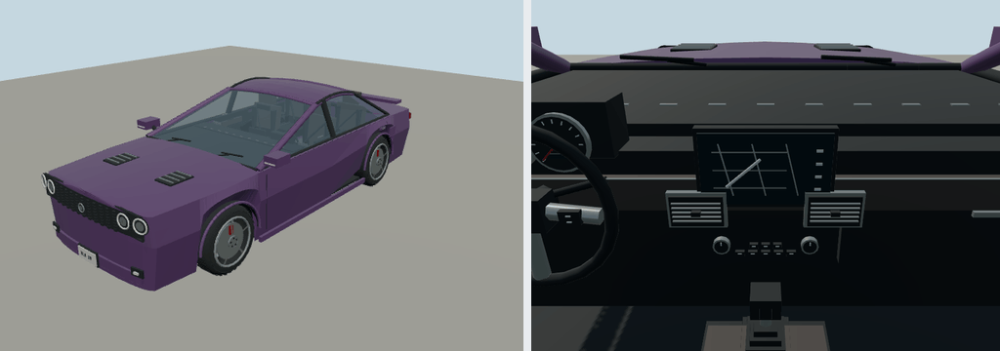

# 2018 Dodge Challenger

R/T coupe; coupe. Original polygonal reference interpretation for close-view driving.

Rounded authoring envelope: 5.027 × 1.923 × 1.46 m, excluding mirrors and rear spare; wheelbase 2.946 m. Geometry includes actual wheel openings, hollow cabin, seats, controls, mirrors, wipers, lamps and separate wheel/caliper transforms. Model-specific proportions and features are editable in models/recipe.json.

[Reference context](https://www.media.stellantis.com/uploads/me/ME/2018/Dodge/Technical-sheet/1806_Dodge_Challenger.pdf) — manufacturer material, including archived brochures where necessary. Sources establish generation/design context; not every authored dimension or trim detail is independently measured. No downloaded geometry or bitmap textures. Dashboard graphics and handling are simplified for play. 

Generate: node packages/entities/scripts/generate-fleet.mjs --ids=dodge-challenger-2018. Import the resulting GLB using the source manifest ID. Capture: node packages/entities/scripts/capture-fleet.mjs --ids=dodge-challenger-2018. The shared generator is packages/entities/scripts/road-vehicle-geometry.mjs. Bulk renders stay in ignored shots/; see content/entities/VARIETY-VEHICLE-REVIEW.md for batch evidence.
