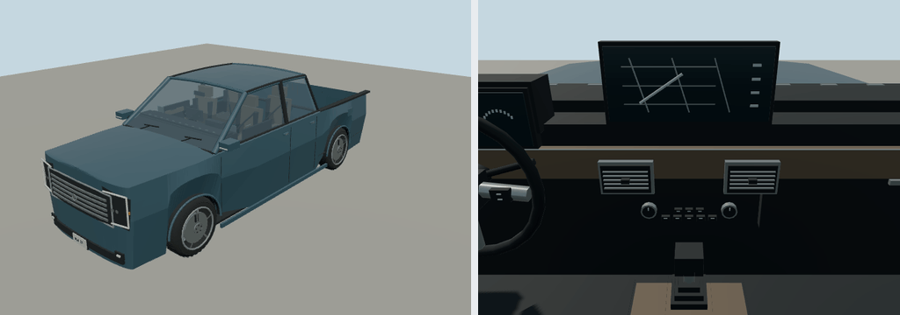

# 2025 Ford F-150

XLT SuperCrew 5.5-foot bed; pickup. Reference interpretation for Molen, with polygonal bodywork, wheel openings, lamp assemblies, cabin furniture and steering controls.

Authoring envelope: 5.893 × 2.029 × 1.96 m (body, excluding mirrors); wheelbase 3.693 m. Rounded visual targets, not a certified engineering reconstruction. The recipe records the selected year/body and editable proportions. Trim details and dashboard graphics are simplified; handling is gameplay tuning, not manufacturer performance data.

Generate: `node packages/entities/scripts/generate-fleet.mjs --ids=ford-f-150-2025`. Import using the source manifest's asset ID, then capture using `packages/entities/scripts/capture-fleet.mjs --ids=ford-f-150-2025`. The shared generator is `packages/entities/scripts/road-vehicle-geometry.mjs`. No bitmap textures or downloaded geometry.

Reference sources (manufacturer design/specification context; not every authored dimension is independently measured):
- [Manufacturer reference](https://s205.q4cdn.com/882619693/files/doc_news/2026/Jan/06/Ford-U-S-Q4-2025-Sales-Release.pdf)
- [Manufacturer reference](https://content.fordpro.com/content/dam/fordpro/us/en-us/pdf/fleet-vehicles/fleet-solutions/2025_FordPro_Solutions_Guide.pdf)

Bulk current renders belong in ignored `shots/`; batch validation is recorded in `content/entities/US-VEHICLE-REVIEW.md`.
