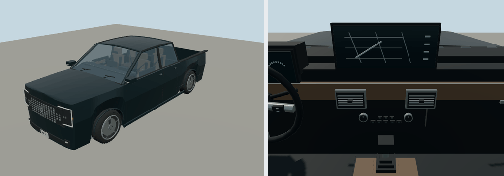

# 2025 GMC Sierra 1500

SLE Crew Cab short bed; pickup. Reference interpretation for Molen, with polygonal bodywork, wheel openings, lamp assemblies, cabin furniture and steering controls.

Authoring envelope: 5.886 × 2.063 × 1.918 m (body, excluding mirrors); wheelbase 3.745 m. Rounded visual targets, not a certified engineering reconstruction. The recipe records the selected year/body and editable proportions. Trim details and dashboard graphics are simplified; handling is gameplay tuning, not manufacturer performance data.

Generate: `node packages/entities/scripts/generate-fleet.mjs --ids=gmc-sierra-1500-2025`. Import using the source manifest's asset ID, then capture using `packages/entities/scripts/capture-fleet.mjs --ids=gmc-sierra-1500-2025`. The shared generator is `packages/entities/scripts/road-vehicle-geometry.mjs`. No bitmap textures or downloaded geometry.

Reference sources (manufacturer design/specification context; not every authored dimension is independently measured):
- [Manufacturer reference](https://www.gmc.com/content/dam/gmc/na/us/english/index/about/download-brochures/2024-models/GMTR23CT300_2024_SIERRA_LD_FO_011024_FINAL.pdf)

Bulk current renders belong in ignored `shots/`; batch validation is recorded in `content/entities/US-VEHICLE-REVIEW.md`.
