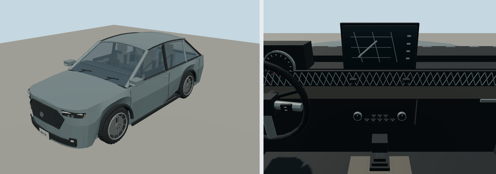

# 2025 Honda CR-V

EX-L; suv. Reference interpretation for Molen, with polygonal bodywork, wheel openings, lamp assemblies, cabin furniture and steering controls.

Authoring envelope: 4.694 × 1.866 × 1.681 m (body, excluding mirrors); wheelbase 2.701 m. Rounded visual targets, not a certified engineering reconstruction. The recipe records the selected year/body and editable proportions. Trim details and dashboard graphics are simplified; handling is gameplay tuning, not manufacturer performance data.

Generate: `node packages/entities/scripts/generate-fleet.mjs --ids=honda-cr-v-2025`. Import using the source manifest's asset ID, then capture using `packages/entities/scripts/capture-fleet.mjs --ids=honda-cr-v-2025`. The shared generator is `packages/entities/scripts/road-vehicle-geometry.mjs`. No bitmap textures or downloaded geometry.

Reference sources (manufacturer design/specification context; not every authored dimension is independently measured):
- [Manufacturer reference](https://www.hondainfocenter.com/2025/CR-V/Feature-Guide/Specifications/)

Bulk current renders belong in ignored `shots/`; batch validation is recorded in `content/entities/US-VEHICLE-REVIEW.md`.
