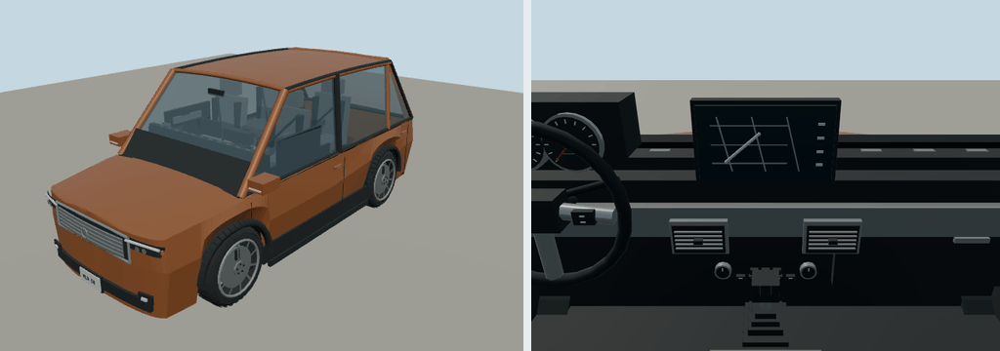

# 2008 Honda Element

EX four-door; suv. Original polygonal reference interpretation for close-view driving.

Rounded authoring envelope: 4.326 × 1.816 × 1.788 m, excluding mirrors and rear spare; wheelbase 2.576 m. Geometry includes actual wheel openings, hollow cabin, seats, controls, mirrors, wipers, lamps and separate wheel/caliper transforms. Model-specific proportions and features are editable in models/recipe.json.

[Reference context](https://hondanews.com/en-US/releases/release-2ec052cb18da3c3c8f3ee3004c34bdfa-2008-honda-element-specifications) — manufacturer material, including archived brochures where necessary. Sources establish generation/design context; not every authored dimension or trim detail is independently measured. No downloaded geometry or bitmap textures. Dashboard graphics and handling are simplified for play. 

Generate: node packages/entities/scripts/generate-fleet.mjs --ids=honda-element-2008. Import the resulting GLB using the source manifest ID. Capture: node packages/entities/scripts/capture-fleet.mjs --ids=honda-element-2008. The shared generator is packages/entities/scripts/road-vehicle-geometry.mjs. Bulk renders stay in ignored shots/; see content/entities/VARIETY-VEHICLE-REVIEW.md for batch evidence.
