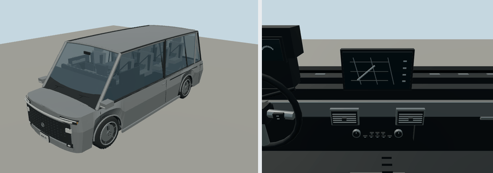

# 2024 Hyundai Staria

Prompt: add diverse recent vehicles for China, Japan, Korea, Europe, South America and Africa, with detailed polygonal driving views and regional traffic weights. Primary target: korea; shared model IDs can serve other markets.

Configuration: left-hand drive regional configuration. Authoring body target 5.253 × 1.997 × 1.99 m, wheelbase 3.273 m. Measurements are rounded reference targets, not a certified dimension sheet. +Y up, +Z forward, ground origin; left-hand steering/driver eye.

Reference: [manufacturer material](https://www.hyundai.news/eu/articles/press-releases/hyundai-motors-staria-mpv-debuts.html). Sources inform shape and identity; model-year trim, upholstery, fittings and handling are simplified. Original geometry, no manufacturer CAD, downloaded meshes or bitmap textures. Display graphics are illustrative.

Geometry: hollow cabin, transparent glazing, individual seats, door cards, belts, vents, controls, pedal boxes, wipers, mirror faces, tire sidewalls, wheel spokes, fixed brakes, grille and lamp optics. Named wheel and steering pivots support gameplay. Doors remain static. Budget: 32,000 triangles and 2 MiB per imported GLB.

Build: node packages/entities/scripts/generate-fleet.mjs --ids=hyundai-staria-2024
Import: molen asset import source/vehicles/hyundai-staria-2024/models/source.glb --id molen.entities.vehicle.hyundai_staria_2024 --project content/entities/project.json
Verify: molen asset inspect molen.entities.vehicle.hyundai_staria_2024 --project content/entities/project.json --verify

See REGIONAL-VEHICLES.md and regional-vehicles-review.json in the entities pack for the batch roster, hash-bound review and capture commands. Bulk captures remain in ignored shots/.
