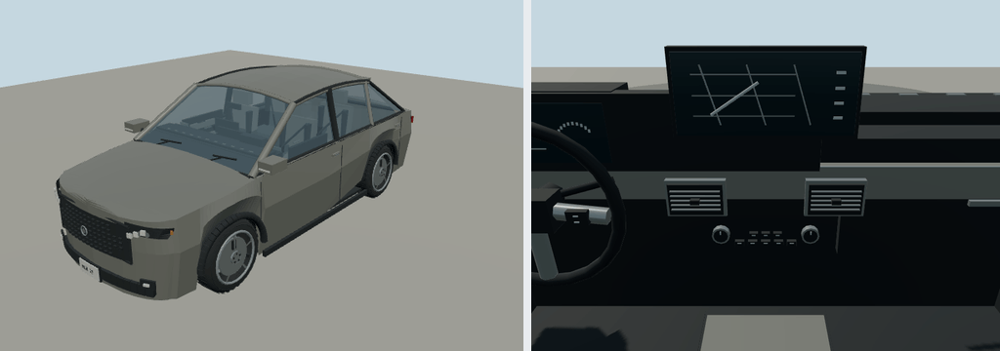

# 2025 Hyundai Tucson

SEL; suv. Reference interpretation for Molen, with polygonal bodywork, wheel openings, lamp assemblies, cabin furniture and steering controls.

Authoring envelope: 4.64 × 1.865 × 1.665 m (body, excluding mirrors); wheelbase 2.756 m. Rounded visual targets, not a certified engineering reconstruction. The recipe records the selected year/body and editable proportions. Trim details and dashboard graphics are simplified; handling is gameplay tuning, not manufacturer performance data.

Generate: `node packages/entities/scripts/generate-fleet.mjs --ids=hyundai-tucson-2025`. Import using the source manifest's asset ID, then capture using `packages/entities/scripts/capture-fleet.mjs --ids=hyundai-tucson-2025`. The shared generator is `packages/entities/scripts/road-vehicle-geometry.mjs`. No bitmap textures or downloaded geometry.

Reference sources (manufacturer design/specification context; not every authored dimension is independently measured):
- [Manufacturer reference](https://www.hyundainews.com/releases/4182)

Bulk current renders belong in ignored `shots/`; batch validation is recorded in `content/entities/US-VEHICLE-REVIEW.md`.
