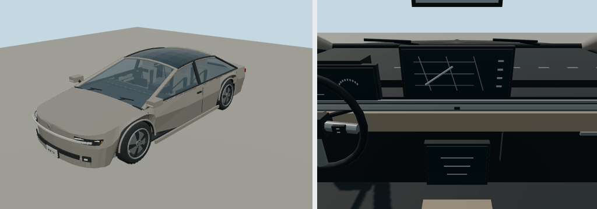

# 2022 Lucid Air

Grand Touring sedan; sedan. Original polygonal reference interpretation for close-view driving.

Rounded authoring envelope: 4.975 × 1.939 × 1.41 m, excluding mirrors and rear spare; wheelbase 2.96 m. Geometry includes actual wheel openings, hollow cabin, seats, controls, mirrors, wipers, lamps and separate wheel/caliper transforms. Model-specific proportions and features are editable in models/recipe.json.

[Reference context](https://ir.lucidmotors.com/news-releases/news-release-details/lucid-announces-new-lucid-air-grand-touring-performance-model/) — manufacturer material, including archived brochures where necessary. Sources establish generation/design context; not every authored dimension or trim detail is independently measured. No downloaded geometry or bitmap textures. Dashboard graphics and handling are simplified for play. 

Generate: node packages/entities/scripts/generate-fleet.mjs --ids=lucid-air-2022. Import the resulting GLB using the source manifest ID. Capture: node packages/entities/scripts/capture-fleet.mjs --ids=lucid-air-2022. The shared generator is packages/entities/scripts/road-vehicle-geometry.mjs. Bulk renders stay in ignored shots/; see content/entities/VARIETY-VEHICLE-REVIEW.md for batch evidence.
