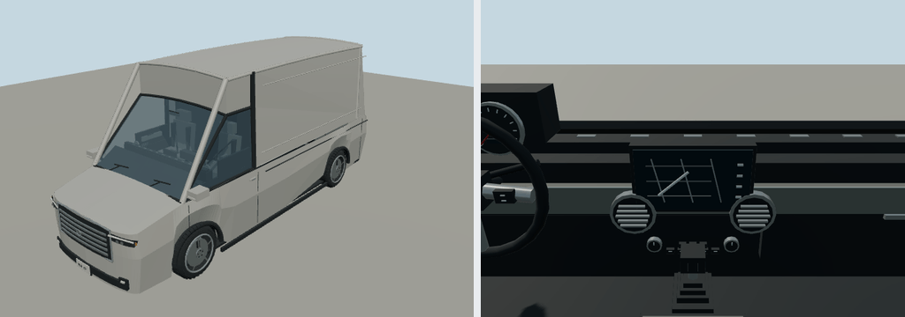

# 2019 Mercedes-Benz Sprinter

2500 cargo, 144-inch wheelbase, high roof; cargo-van. Original polygonal reference interpretation for close-view driving.

Rounded authoring envelope: 5.932 × 2.02 × 2.642 m, excluding mirrors and rear spare; wheelbase 3.665 m. Geometry includes actual wheel openings, hollow cabin, seats, controls, mirrors, wipers, lamps and separate wheel/caliper transforms. Model-specific proportions and features are editable in models/recipe.json.

[Reference context](https://media.mbusa.com/news/quick-reference-guide-new-sprinter-vs30) — manufacturer material, including archived brochures where necessary. Sources establish generation/design context; not every authored dimension or trim detail is independently measured. No downloaded geometry or bitmap textures. Dashboard graphics and handling are simplified for play. The cargo area has solid panels and a cab partition; doors do not open. 

Generate: node packages/entities/scripts/generate-fleet.mjs --ids=mercedes-benz-sprinter-2019. Import the resulting GLB using the source manifest ID. Capture: node packages/entities/scripts/capture-fleet.mjs --ids=mercedes-benz-sprinter-2019. The shared generator is packages/entities/scripts/road-vehicle-geometry.mjs. Bulk renders stay in ignored shots/; see content/entities/VARIETY-VEHICLE-REVIEW.md for batch evidence.
