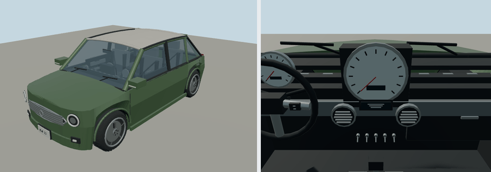

# 2013 MINI Cooper

Hardtop, R56; hatchback. Original polygonal reference interpretation for close-view driving.

Rounded authoring envelope: 3.723 × 1.683 × 1.407 m, excluding mirrors and rear spare; wheelbase 2.467 m. Geometry includes actual wheel openings, hollow cabin, seats, controls, mirrors, wipers, lamps and separate wheel/caliper transforms. Model-specific proportions and features are editable in models/recipe.json.

[Reference context](https://www.press.bmwgroup.com/usa/article/detail/T0136102EN_US/complete-2013-mini-lineup-pricing-and-equipment-updates?language=en_US) — manufacturer material, including archived brochures where necessary. Sources establish generation/design context; not every authored dimension or trim detail is independently measured. No downloaded geometry or bitmap textures. Dashboard graphics and handling are simplified for play. 

Generate: node packages/entities/scripts/generate-fleet.mjs --ids=mini-cooper-2013. Import the resulting GLB using the source manifest ID. Capture: node packages/entities/scripts/capture-fleet.mjs --ids=mini-cooper-2013. The shared generator is packages/entities/scripts/road-vehicle-geometry.mjs. Bulk renders stay in ignored shots/; see content/entities/VARIETY-VEHICLE-REVIEW.md for batch evidence.
