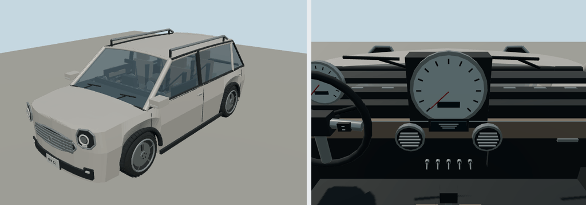

# 2012 MINI Cooper Countryman

Prompt: add a Mini Cooper, a white 2012 MINI Cooper Countryman and a dark gray 2019 Acura MDX. The existing 2013 MINI Cooper covers the standard hatchback; this is a distinct additional model.

Selected configuration: Cooper automatic, R60; white body and roof. Body 4.097 × 1.789 × 1.561 m, wheelbase 2.595 m, +Y up, +Z forward, ground origin. Driving footprint also includes mirrors and bumper fittings. Colors are authored defaults and the ambient color palette retains the requested paint.

Reference: [manufacturer specifications](https://www.press.bmwgroup.com/global/article/attachment/T0127716EN/194917). Dimensions and visual identity are reference-based; trim, cabin layout and handling are simplified, not factory CAD or a performance simulation.

Deterministic recipe-driven polygonal geometry via packages/entities/scripts/road-vehicle-geometry.mjs. Budget: 26,000 triangles, no bitmaps or image-generation prompts. Real window openings, seats, door cards, belts, vents, pedals, mirror/wiper fittings, lamp housings, grille, wheels, fixed brakes and named steering/speed pivots. Doors and body panels are static; display graphics are illustrative.

Generate: node packages/entities/scripts/generate-fleet.mjs --ids=mini-cooper-countryman-2012

Import through molen asset import with --id molen.entities.vehicle.mini_cooper_countryman_2012 --project content/entities/project.json; verify with asset inspect --verify. The batch showroom and hash-bound render/validation evidence are in content/entities/MINI-ACURA.md and mini-acura-review.json.
