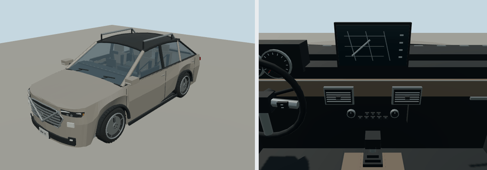

# 2025 Nissan Rogue

SV; suv. Reference interpretation for Molen, with polygonal bodywork, wheel openings, lamp assemblies, cabin furniture and steering controls.

Authoring envelope: 4.648 × 1.839 × 1.689 m (body, excluding mirrors); wheelbase 2.705 m. Rounded visual targets, not a certified engineering reconstruction. The recipe records the selected year/body and editable proportions. Trim details and dashboard graphics are simplified; handling is gameplay tuning, not manufacturer performance data.

Generate: `node packages/entities/scripts/generate-fleet.mjs --ids=nissan-rogue-2025`. Import using the source manifest's asset ID, then capture using `packages/entities/scripts/capture-fleet.mjs --ids=nissan-rogue-2025`. The shared generator is `packages/entities/scripts/road-vehicle-geometry.mjs`. No bitmap textures or downloaded geometry.

Reference sources (manufacturer design/specification context; not every authored dimension is independently measured):
- [Manufacturer reference](https://usa.nissannews.com/en-US/nissan-press-kit-by-model)
- [Manufacturer reference](https://www.nissanusa.com/content/dam/Nissan/us/vehicle-brochures/2025/2025-nissan-rogue-brochure-en.pdf)

Bulk current renders belong in ignored `shots/`; batch validation is recorded in `content/entities/US-VEHICLE-REVIEW.md`.
