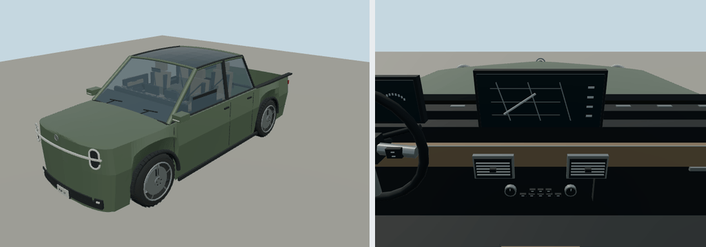

# 2023 Rivian R1T

Adventure pickup; pickup. Original polygonal reference interpretation for close-view driving.

Rounded authoring envelope: 5.514 × 2.014 × 1.986 m, excluding mirrors and rear spare; wheelbase 3.449 m. Geometry includes actual wheel openings, hollow cabin, seats, controls, mirrors, wipers, lamps and separate wheel/caliper transforms. Model-specific proportions and features are editable in models/recipe.json.

[Reference context](https://assets.rivian.com/2md5qhoeajym/530xs9hu11xOKefT2JrvA5/8fa7788e5e55b88bbd015838b55ce18e/r1t-og-en-us-20230130.pdf) — manufacturer material, including archived brochures where necessary. Sources establish generation/design context; not every authored dimension or trim detail is independently measured. No downloaded geometry or bitmap textures. Dashboard graphics and handling are simplified for play. 

Generate: node packages/entities/scripts/generate-fleet.mjs --ids=rivian-r1t-2023. Import the resulting GLB using the source manifest ID. Capture: node packages/entities/scripts/capture-fleet.mjs --ids=rivian-r1t-2023. The shared generator is packages/entities/scripts/road-vehicle-geometry.mjs. Bulk renders stay in ignored shots/; see content/entities/VARIETY-VEHICLE-REVIEW.md for batch evidence.
