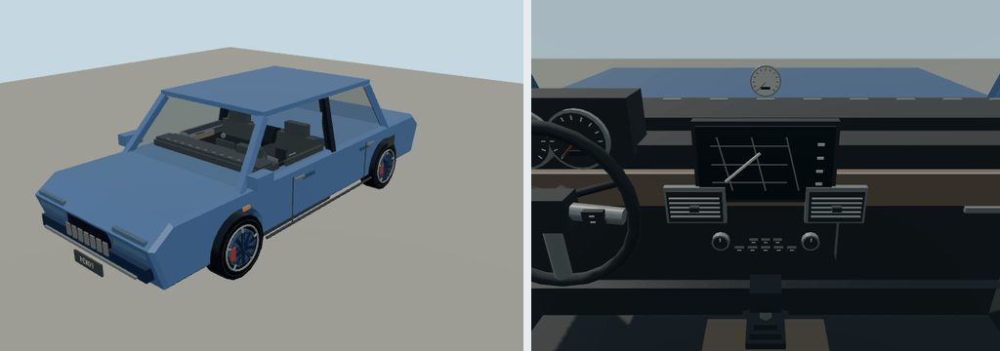

# Bendy Sedan

Portable source bundle for `molen.entities.vehicle.sedan`. Its definition contains the complete resolved vehicle physics, seats, camera/visual bindings, initial state, and behavior-script attachment; it has no dependency on a separate concrete vehicle preset.

- Editable recipe: `models/recipe.json` (shared builder: `packages/entities/scripts/road-vehicle-geometry.mjs`)
- Entity definition: `entity.types.json`
- Behavior: `scripts/interactions.ts`
- Imported output: `assets/molen/entities/vehicle/sedan/asset.json`

`node packages/entities/scripts/generate-fleet.mjs --ids=sedan` builds the road-vehicle recipe into
`models/detailed.glb` (the recipe's declared `output`), which is the imported runtime source. Its
proportions follow a current C-segment three-box sedan (reference: Mazda3 sedan, 2019). The original
boxy `models/source.glb` is kept only as the archived legacy master; nothing builds from it.
