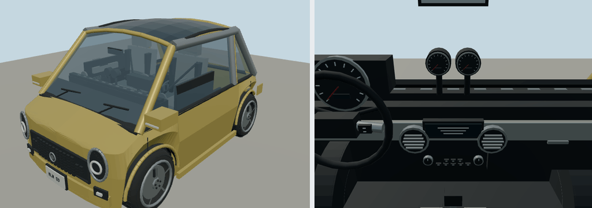

# 2009 Smart fortwo

Passion coupe, second generation; city. Original polygonal reference interpretation for close-view driving.

Rounded authoring envelope: 2.695 × 1.559 × 1.542 m, excluding mirrors and rear spare; wheelbase 1.867 m. Geometry includes actual wheel openings, hollow cabin, seats, controls, mirrors, wipers, lamps and separate wheel/caliper transforms. Model-specific proportions and features are editable in models/recipe.json.

[Reference context](https://www.auto-brochures.com/makes/Smart/Smart_US%20Fortwo_2009.pdf) — manufacturer material, including archived brochures where necessary. Sources establish generation/design context; not every authored dimension or trim detail is independently measured. No downloaded geometry or bitmap textures. Dashboard graphics and handling are simplified for play. 

Generate: node packages/entities/scripts/generate-fleet.mjs --ids=smart-fortwo-2009. Import the resulting GLB using the source manifest ID. Capture: node packages/entities/scripts/capture-fleet.mjs --ids=smart-fortwo-2009. The shared generator is packages/entities/scripts/road-vehicle-geometry.mjs. Bulk renders stay in ignored shots/; see content/entities/VARIETY-VEHICLE-REVIEW.md for batch evidence.
