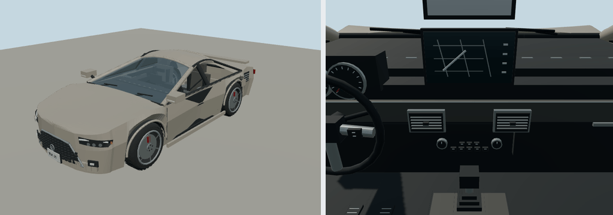

# 2024 Toyota GR Supra

3.0 Premium coupe; coupe. Original polygonal reference interpretation for close-view driving.

Rounded authoring envelope: 4.379 × 1.854 × 1.294 m, excluding mirrors and rear spare; wheelbase 2.47 m. Geometry includes actual wheel openings, hollow cabin, seats, controls, mirrors, wipers, lamps and separate wheel/caliper transforms. Model-specific proportions and features are editable in models/recipe.json.

[Reference context](https://pressroom.toyota.com/vehicle/2024-toyota-gr-supra/) — manufacturer material, including archived brochures where necessary. Sources establish generation/design context; not every authored dimension or trim detail is independently measured. No downloaded geometry or bitmap textures. Dashboard graphics and handling are simplified for play. 

Generate: node packages/entities/scripts/generate-fleet.mjs --ids=toyota-gr-supra-2024. Import the resulting GLB using the source manifest ID. Capture: node packages/entities/scripts/capture-fleet.mjs --ids=toyota-gr-supra-2024. The shared generator is packages/entities/scripts/road-vehicle-geometry.mjs. Bulk renders stay in ignored shots/; see content/entities/VARIETY-VEHICLE-REVIEW.md for batch evidence.
