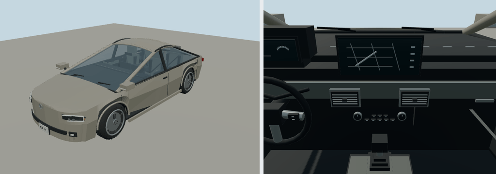

# 2024 Toyota Prius

XLE; fastback. Reference interpretation for Molen, with polygonal bodywork, wheel openings, lamp assemblies, cabin furniture and steering controls.

Authoring envelope: 4.6 × 1.782 × 1.43 m (body, excluding mirrors); wheelbase 2.75 m. Rounded visual targets, not a certified engineering reconstruction. The recipe records the selected year/body and editable proportions. Trim details and dashboard graphics are simplified; handling is gameplay tuning, not manufacturer performance data.

Generate: `node packages/entities/scripts/generate-fleet.mjs --ids=toyota-prius-2024`. Import using the source manifest's asset ID, then capture using `packages/entities/scripts/capture-fleet.mjs --ids=toyota-prius-2024`. The shared generator is `packages/entities/scripts/road-vehicle-geometry.mjs`. No bitmap textures or downloaded geometry.

Reference sources (manufacturer design/specification context; not every authored dimension is independently measured):
- [Manufacturer reference](https://pressroom.toyota.com/toyota-motor-north-america-reports-2025-u-s-sales-results/)
- [Manufacturer reference](https://pressroom.toyota.com/whats-new-for-2025/)
- [Manufacturer reference](https://www.toyota.com/content/dam/toyota/brochures/pdf/2024/prius_ebrochure.pdf)

Bulk current renders belong in ignored `shots/`; batch validation is recorded in `content/entities/US-VEHICLE-REVIEW.md`.
