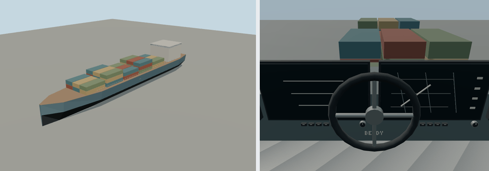

# Bendy Container Ship

Original brief: add diverse cars, motorcycles, bicycles, boats, cargo ships and ferries to Molen.

Editable recipe: models/recipe.json. Shared engine authoring capability: packages/entities/scripts/fleet-geometry.mjs. Regenerate in the engine repository with `node packages/entities/scripts/generate-fleet.mjs --ids=container-ship`. The recipe owns all concrete values; no sibling bundle supplies data.

Dimensions: 150 m long × 24 m wide × 25 m nominal height. +Y up, +Z forward; Y=0 is the waterline; draft 7 m. Bright polygonal medium-fi style, flat PBR colors, no image textures or image-generation prompts. Static pieces merge by material; wheel groups preserve named spin pivots. Convex collision is derived by the importer. Geometry is a stylized generic design, not a licensed make.

Supports powered helm controls, deterministic buoyancy and swells, and driver/passenger seats through `@bendyline/molen-kernel/boats`. Ambient traffic follows authored water routes. Boarding points and deck-height exits are owned by entity.types.json; the sailboat uses its auxiliary motor. See docs-src/guide/boats.md in the engine repository.
