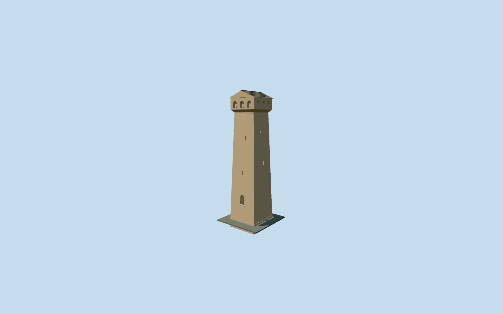

# Svanetian tower

Reusable Svanetian defensive-tower type: tall tapered warm-stone shaft, sparse recessed arrow slits and elevated closed timber door, four projecting crown faces with three deep arched mouths each, and shallow stone/slate gable roof. Medium-fi exterior based on two ordinary photographs, not a replica of a named tower.

## Evidence and reconstruction

Published dimensions and reconstructed details are separated in spec.json. Primary references:

- [Reference](https://commons.wikimedia.org/wiki/File:Towers_of_Svaneti.jpg)
- [Reference](https://commons.wikimedia.org/wiki/File:Svanų_bokštas_Mestijoje_(Photo_by_deguonis_2009).jpg)

No third-party geometry, photograph or bitmap texture is embedded. Shared surface graphs come from the central library; vertex tints carry model colors. Glazing uses PBR materials; transparent surfaces are declared per model.

## Model and axes

1,172 triangles; 3,516 vertices; 4 material groups; 143,536 bytes. Native bounds: -2.800, -1.500, -2.800 to 2.800, 23.070, 2.800. Source hash: `sha256:f5f48d551398a9a1933d014c0708121a0efbf7d1995138c63048e7c9f96c4995`.

{"up":"+Y","front":"+Z","origin":"Ground attachment plane Y=0; bounded footing reaches Y=-1.5m. No unique geographic anchor."}

Reusable type only. Map rules establish individual instance locations; this preview has no geographic placement.

## Reproduce

Run `node packages/worldgen/scripts/generate-additional-landmarks.mjs --ids=N0594` (or add `--check`). The generator preserves manually edited masters by checking their baseline hashes. Import through the standard authored-model workflow with optimization disabled; then capture all QA cameras, including shared-surface views.

## Pending work

- This regional building type is not a unique named landmark. No geographic centroid is published as a placement.
- Nominal5.6m base/23m height, taper, slit inventory, upper arches, roof pitch and elevated-door facing are authored picture-led type values, not measured dimensions.
- Only explicit type names with classification and regional bounds, or tower:type=svanetian in that region, may select this model. Hotels, museums, generic attractions, untyped square buildings and partial-name matches are excluded.
- Mapped direction/complete footprint controls instance orientation and fit when supplied; point-only type labels have no directed facade evidence and keep the declared fallback. No invented survey orientation.
- Exterior only; no copied photo textures, furnished interior, adjoining houses, terrain slab or active unique-site identity.
- Ground attachment plane isY=0 with a bounded1.5m subgrade footing. This is a coarse-terrain visualization aid, not a measured or engineered historical foundation. No ground flattening/cutout.

This bundle follows the medium-fi standard. Medium-fi appearance and geographic fit are reviewed separately. Hash-bound visual acceptance is recorded separately after capture inspection.
