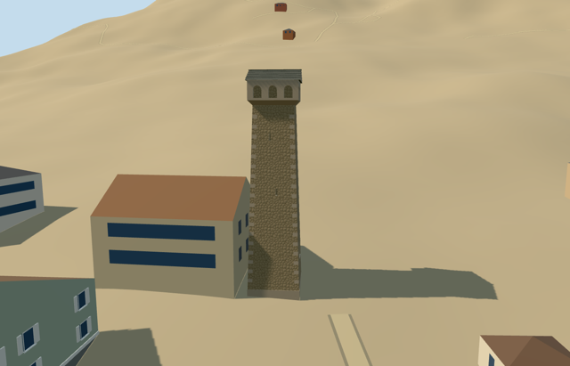

# svanetian_tower — Svanetian tower (reusable regional type)

Reviewed2026-10-20 in one continuous picture/map/build/inspect/fix pass.

## Appearance

Inspected all current47 source/shared/context/native views. Tall tapered stone mass, sparse recessed arrow slits, elevated closed timber door, four projecting crown faces with three real deep arch mouths, and shallow gabled stone/slate roof remain recognizable across four authored levels. Corrected inward opening-reveal winding during this construction pass; the crown no longer appears to have missing surfaces. Reused fieldstone replaces the overly regular initial ashlar binding. This is the planned regional type, not a stand-in for a specific named landmark.

## Shared surfaces and browser levels

Four existing256-square graphs: stone_drywall, stone_limestone_raw, slate and wood_plain; metric repeats/linear vertex tints, zero embedded bitmap copies. At most four runtime draws (skyline one), separate vertex streams, equal CPU/GPU counts and shared graph reads once. Library eviction releases all model geometry.

| Level | Triangles | Bytes | Draws |
| --- | ---: | ---: | ---: |
| skyline | 392 | 39676 | 1 |
| district | 580 | 55868 | 4 |
| street | 1124 | 99968 | 4 |
| closeup | 1172 | 104868 | 4 |

Inspected three context distances at noon/late afternoon, Economy/High, texture-free silhouette, details and all transitions. Levels392/580/1124/1172 triangles; first skyline+district fetch95544bytes, comfortably under phone/laptop budgets. Source1,172triangles/143,536bytes. Physical-device and dense-city timings remain pending.

## Category matching and approximate real-map fit

The exact typed point identifies a reusable Svanetian tower. Its sole complete containing shell supplies scale and an undirected longest-edge axis (2.169215116144rad in this example); it does not establish the elevated entrance facing or certify a named tower replica. Heights/details remain picture-led type values. Subgrade footing is a coarse-DEM visualization approximation; terrain and water remain unchanged. Production semantic decoder finds real PMTiles17604166302585 (kind=attraction,name=Svan tower), paired only with containing building35184673266155. Mapped instance center42.7310013771,43.0488687988, scale[1.04772525,1,.98334011]. Original415 native buildings become414 unchanged independent buildings only after model load; failed loading preserves415. Original6m grid, paths and100893.452488m2 water remain. All four loaded levels and failure/unload pass; out-of-region, hotel and partial-name cases produce zero category instances.

## Limits

This regional building type is not a unique named landmark. No geographic centroid is published as a placement. Nominal5.6m base/23m height, taper, slit inventory, upper arches, roof pitch and elevated-door facing are authored picture-led type values, not measured dimensions. Only explicit type names with classification and regional bounds, or tower:type=svanetian in that region, may select this model. Hotels, museums, generic attractions, untyped square buildings and partial-name matches are excluded. Mapped direction/complete footprint controls instance orientation and fit when supplied; point-only type labels have no directed facade evidence and keep the declared fallback. No invented survey orientation. Exterior only; no copied photo textures, furnished interior, adjoining houses, terrain slab or active unique-site identity. Ground attachment plane isY=0 with a bounded1.5m subgrade footing. This is a coarse-terrain visualization aid, not a measured or engineered historical foundation. No ground flattening/cutout.

## Selected checks

Six Khronos validations:0errors/0warnings.144 actual mesh probes;47 inspected views; strict medium-fi, scene/sim30, selected import, focused matching/readiness/source tests pass. Category rule evidence is separate from unique landmark placement approval. Existing unique-anchor identity rejection is retained.

Rebuild: node packages/worldgen/scripts/generate-additional-landmarks.mjs --ids=svanetian_tower; node packages/worldgen/scripts/import-structure-models.mjs --ids=svanetian_tower; node packages/tooling/scripts/generate-landmark-lods.mjs --ids=svanetian_tower --force.

Source:sha256:f5f48d551398a9a1933d014c0708121a0efbf7d1995138c63048e7c9f96c4995

Runtime:sha256:41709f4ebd8966bc7c1e348a56f329fa28d463e8d77c0230b8aa3330fd981d67

Input:sha256:e9b289fd7a58354f1909d522de2f894ab3ea64c40e095ffd2b0344cc8f5c55ad

## Viewed ordinary pictures

https://commons.wikimedia.org/wiki/File:Towers_of_Svaneti.jpg — Ekkatterrinna; CC-BY-SA-4.0. Viewed only; no pixels copied.

https://commons.wikimedia.org/wiki/File:Svanų_bokštas_Mestijoje_(Photo_by_deguonis_2009).jpg — deguonis; CC-BY-2.0. Viewed only; no pixels copied.
