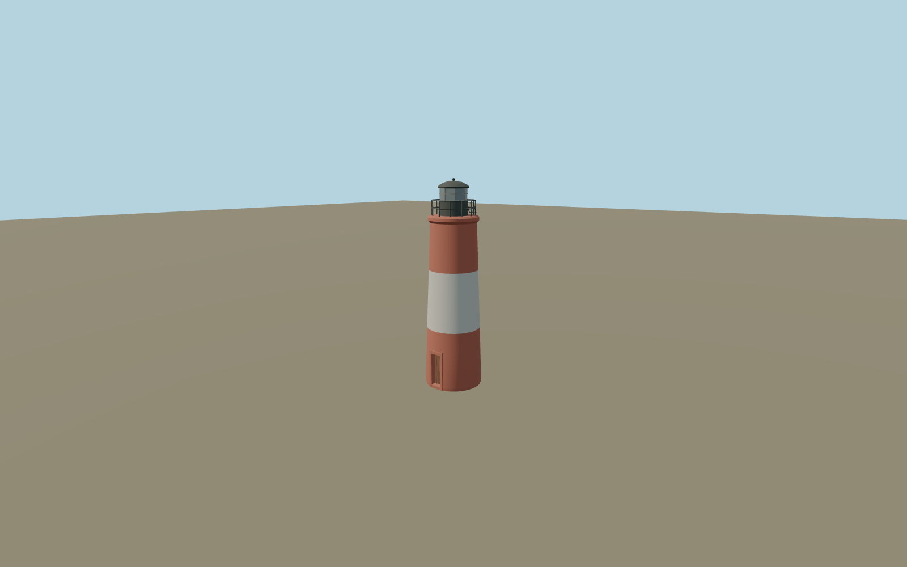

# Les Éclaireurs Lighthouse — N0657

Small isolated rough-masonry lighthouse with a red-white-red taper, low recessed wooden door, projecting red gallery lip, delicate black two-rail gallery, black lantern pedestal and domed roof, metal astragals and paired tilted solar panels.

## Identity and evidence

Exact catalog identity **Q3378140**. Source facts: `{"heightMeters":11,"baseDiameterApproxMeters":3,"year":1920,"basis":"Provincial tourism publishes11m height. National Argentina tourism photograph supplies the three bands, door, gallery, lantern and small inclined panels. Base diameter and component dimensions are photograph-scaled; mapped exact-QID node8127284556 fixes position.","originalMasterHash":"sha256:738d6fada7a6d09478850bb02aa34b5013a70907662f19fd4865b9ceceddd074","originalMasterRecipe":"packages/worldgen/scripts/eclaireurs-browser-model.mjs#buildEclaireursMaster"}`. The source specification keeps published dimensions separate from reconstructed details.

- https://tierradelfuego.tur.ar/es/actividades/s/7
- https://turismoushuaia.com/actividad/faro-les-eclaireurs/
- https://www.argentina.gob.ar/jefatura/turismo/viaja-por-argentina/navegar-por-el-canal-de-beagle
- https://www.argentina.gob.ar/sites/default/files/ushuaia_108.jpg
- https://www.openstreetmap.org/node/8127284556

Original geometry and shared procedural materials. Official photographs are research references only; no reference imagery or third-party mesh is embedded or redistributed.

## Authored geometry and materials

8,320 triangles, 15,728 vertices, 4 surface groups; 668,840 source bytes. SHA-256: `sha256:738d6fada7a6d09478850bb02aa34b5013a70907662f19fd4865b9ceceddd074`. Actual bounds: -1.530, 0.000, -1.530 to 1.530, 11.000, 1.523 m.

Shared canonical material graphs with metric UV repeats in extras.molenSurface; portable glTF PBR factors and vertex colors remain. Dark recesses/lantern panels retain local fallback materials. Shared references: `matgraph:molen.worldgen.material.plaster_lime` (2 × 2 m), `matgraph:molen.worldgen.material.metal_painted` (2 × 2 m), `matgraph:molen.worldgen.material.wood_plain` (2 × 0.25 m). Model-native axes: {"up":"+Y","front":"+Z doorway approximately south; exact door/panel compass phase is not claimed.","origin":"Mapped lighthouse anchor; Y0 standard viewer PMTiles zero datum."}.

## Placement proposal

The inspected picture supports the red/white/red tapered tower, low door, open black gallery/lantern and bounded rock under its base. Retained mapped node supplies location. Heading0 is an explicitly approximate south-facing doorway and north-facing panels, not a measured bearing. Standard viewer PMTiles are zero at this very small islet and do not resolve its rock. Browser tiers therefore include a bounded roughly10m rock footing rising1.1m above that datum and retain the11m tower height. This is an approximate visual footing, not the complete island or a surveyed tide/focal-height datum. Proposed anchor -68.0832452, -54.8715452 (longitude, latitude), heading 0 radians. Elevation policy: **terrain-contact**. This is a reviewable proposal, not a completed site-fit certification. Ground models require terrain contact; offshore models also require water-datum and base-height checks.

## Limitations and review

- The modeled exterior follows the cited published facts and inspected photographs. Unpublished dimensions and local fittings are explicitly photo-proportioned; no claim of engineering survey accuracy is made.
- Portable PBR and shared metric surfaces are provided. Surface weathering, material color under local lighting and fine facade relief require close render review before maximum-detail acceptance.
- Painted masonry uses the shared lime-plaster surface to preserve the primary photograph's fine rough finish, rather than exposed stone joints. Door and solar-panel compass positions are photograph reconstructed; no measured azimuth is claimed. Natural rocky island and seabirds are host environment features.

Near/far fixtures are in `spec.qaCameras`. Float32 finite geometry, triangle degeneracy and winding are checked by the generator. Current rendering, shared-material, maximum-fidelity and geographic review results are recorded in `qa.json` and the readiness ledger; source generation alone does not approve a model.

Regenerate with `node packages/worldgen/scripts/generate-lighthouse-models.mjs --ids=N0657`; add `--check` for reproducibility. Editable component recipes are in `packages/worldgen/scripts/lighthouse-atlantic-models.mjs`. The generator protects artist-edited master hashes and preserves import/capture/shared-capture/QA documents.
