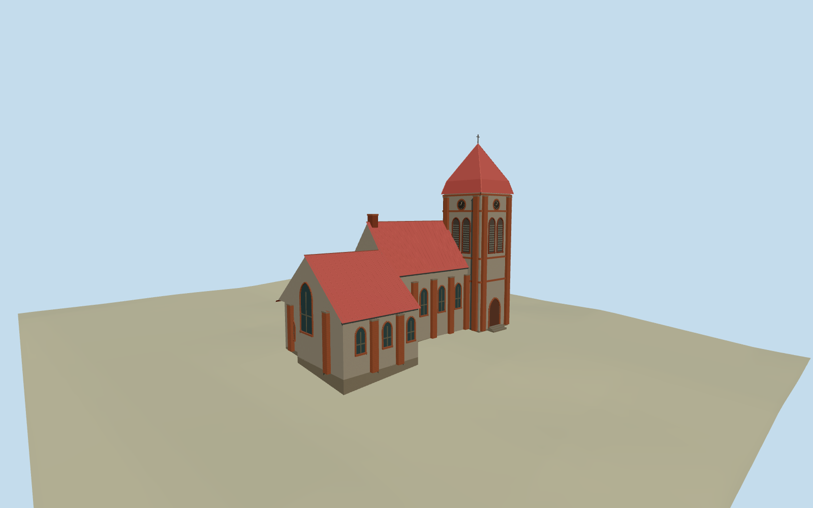

# Christ Church Cathedral

Stanley’s Anglican cathedral in grey local granite and red brick, with a corrugated red roof and northwest clock tower.

Authoring state: **review-in-qa.json**. Current completion evidence is in [qa.json](qa.json) and the [completion ledger](../../../../qualla-structures/batches/qualla-004.PROGRESS.md).

- [Christ Church Cathedral](https://qualla.com/christ-church-cathedral-falkland-islands/)

Uses the historic roof profile and brickwork with approximations for less visible ancillary doors, stained glass, clock fittings and small roof ornaments. The adjacent Whalebone Arch is a separate mapped structure.

Build: `node content/worldgen/source/places/4w/4wy/christ_church_cathedral/models/generate-christ-church-cathedral.mjs`. Add `--check` to verify exact regeneration. 7047 triangles; 5 materials; no embedded photographs.
