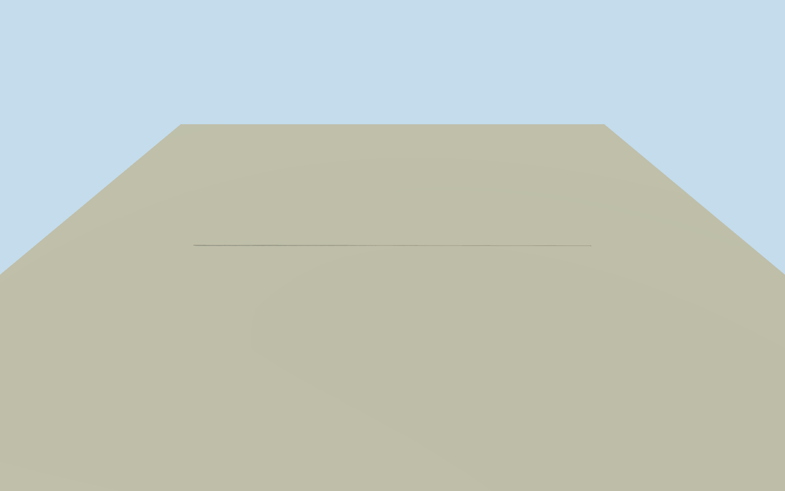

# Las Raíces Tunnel — complete existing bore and both portals

Whole original single-bore road tunnel, both open portal headwalls/integral wingwalls and traffic signals, complete continuous underground horseshoe liner and paved deck. Primary ministry numerical facts and complete original numeric alignment; estimated portal architecture and grade. No imagery used.

Authoring state: **review-in-qa.json**. Current completion evidence is in [qa.json](qa.json) and the [completion ledger](../../../../qualla-structures/batches/qualla-002.PROGRESS.md).

- [Las Raíces Tunnel](https://qualla.com/las-raices-tunnel/)

Whole existing Las Raíces single-bore4528m road tunnel, complete mapped underground alignment, continuous horseshoe lining and paved deck, both terminal mouths/headwalls and intrinsic wingwalls/traffic signals. Both original numeric endpoints verified against surface approaches. No one-portal proxy, invented ventilation plant, future parallel bore or detached operator/toll building. Portal architecture, liner, exact grade and finish are explicit estimates; all imagery unused. Historical2020 existing-tunnel phase.

Original seven buffered numeric fragments give13 unique quantized controls and4552.335m route, versus4528m ministry reported length. Original coordinates retained without stretching or a claimed survey. Both terminal controls meet original surface road approaches; original story pin at northwest portal is unchanged.

Actual original Ministry2020engineering PDFpages7-8 fixes existing tunnel4528m/5.9m total height/4.75m base/4.2m clearance, alternating one-way and end traffic lights; explicitly no ventilation. Older connectivity report page1371010m altitude/4.2m width/5.6m height is context only, not a portal elevation survey. All source photographs/figures/maps/drawings unused.

Original8192m/16641-height/16-raw-tile field and whole frame fixed before floors/main sections. Datum1432.0946m is mountain-surface provider datum, not road elevation. Portal road floors selected once as original64m-grid bilinear ground+0.04m, northwest1043.213m/southeast1033.591m; linear grade between them explicitly estimated. No surveyed historic grade/datum conversion. Underground alignment is expected to be hidden by mountain terrain. Source field not cut, masked, flattened, refetched or refit; frozen floors/main sections never moved for screenshots.

Continuous single-bore horseshoe lining has primary clear section4.75m base/5.9m total height, semicircular2.375m crown radius and3.525m spring height explicitly estimated. Liner thickness0.4m, asphalt deck0.22m, drainage kerbs and joint spacing/profile/finish estimated. Full lining and deck connect both original ends at every LOD; no invented machinery/ventilation/second bore.

Both terminal headwalls are complete open horseshoe rings, estimated8.75m width/7.8m height/2.2m depth, integral8m wingwalls widening2.2m each side, short complete roadway aprons and intrinsic traffic-light poles. Exact portal architecture/stone census/cornice/signage/floor/finish unknown; no protected portal photograph traced. Independent operator huts/toll buildings, separate approaches/bridges, mountain mass and future parallel tunnel excluded.

Whole physical existing tunnel historical2020phase, currentWorldEligible false. Nominal5m plan and5m height uncertainty for portal architecture/grade, wider DEM/native-registration uncertainty possible. Original coarse terrain can bury or expose mouths/wingwalls and camera views; no ground contact/vertical registration or photographic fidelity claim. All12Qualla families/allotherimagery unused.

Build: `node content/worldgen/source/places/63/63j/las_raices_tunnel/models/generate-house.mjs`. Add `--check` to verify exact regeneration. 18876 triangles; 4 materials; no embedded photographs.
