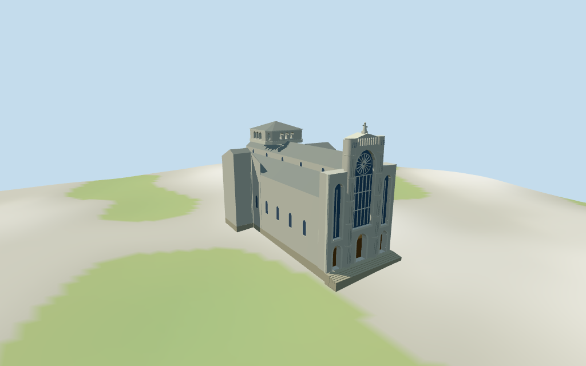

# N0343 — Cathedral of the Most Holy Conception review

Reviewed 2026-10-14 against current source/runtime bytes. Accepted for the recorded medium-fi exterior and approximate geographic scope.

## Built result

Inspected all 11 final portable/source-terrain views. Present cathedral has rounded/banded front pylons framing a monumental recessed glazed arch with selected rose spokes/vertical mullions,three closed recessed portals/warm lunette fields,tall side arches,upper crown slots,grey metal nave/aisles,faceted low crossing lantern,rounded rear apse/transverse arms and approximate entry steps. Corrected a stray doorway reveal triangle,recessed front panels to expose pylon projection and added real arch jamb surfaces. Roofline figure is a simple faceted silhouette,not an exact sculpture.

Individual medium-fi present exterior from useful elevated/oblique pictures and standard viewer PMTiles/DEM. One mapped parent supplies 35m overall height;there are no building-part height controls. Lower body,aisles,nave,apse,front/lantern stages,openings and figure proportions are picture-led estimates. Rounded pylons,central glazing/rose,three doors and low crossing lantern carry recognition. Exact statue/mosaic figures,full interiors,adjacent civic/office wings,plaza and certified walking excluded. Physical phone/laptop timings pending.

## Shared materials and placement

Inspected all 11 final shared-material/geographic views. Four existing 256-square graphs provide concrete,standing-seam metal,weathered limestone and plain wood. Wall/trim reuse concrete;warm lunette fields/flutes are linear vertex tints. Glass is flat blue-gray,UVs metric and skyline roofs use mean tints. Each graph reads once. Unload leaves zero live model geometries and restores ground. Flat placement checks the signed plan;source heightmap views complement coarse terrain contact. Ground colors are diagnostic.

Retained exact-QID way124858478 plus one current 35m PMTiles parent preserve the approximately 69x38m cathedral outline. Native+X faces the plaza/three-door front and native-X the rounded rear apse,at heading 0.517007473518rad. Raw transforms match exactly without rescaling. An internal rigid 2.47degree frame follows the mapped body skew;all reconstructed native points preserve scale. Foundation retains the full parent,while front/body/apse masses are separately profiled. StandardDEM datum 34.659053m and estimated 0.7m floor clear sampled footprint peak 0.360m. Exact plaza/stair/entry joins remain approximate;no road replacement or certified walking.

Inspected all 27 final Earth-lighting views: Economy/High,noon/late,three distances,silhouette,six details,four matched levels and four transitions. Skyline retains rounded pylons,central glazed arch,stepped masses,rounded apse,crossing lantern and a simple roofline finial. District adds textures,recessed closed doors/window backing and selected rose/mullions. Street adds actual crown/lantern slots,selected bands and coarse figure arms;closeup refines arch/pylon facets,rose spokes and fluting. Detail/facet changes remain visible. Modern-apartment neighbors are synthetic context,not local map buildings.

## Browser budgets

| Level | Triangles | Bytes | Draws |
| --- | ---: | ---: | ---: |
| skyline | 667 | 68400 | 1 |
| district | 2208 | 216748 | 6 |
| street | 4937 | 489600 | 6 |
| closeup | 6847 | 692768 | 6 |

Skyline plus district: **285148 bytes** of geometry. Source master: **825456 bytes /6847 triangles**. Four graphs cached separately;no embedded images. Initial geometry excludes graph definitions/texture generation. Separate POSITION/NORMAL streams have equal CPU/GPU buffer totals. Physical device timings pending.

## Verification

- Exact targeted source reproduction with --ids=N0343 --check;current source/import/derivative/review hashes match.
- Six GLBs pass Khronos with zero errors,warnings or embedded images. All four browser levels meet triangle/draw/download budgets.
- Raw current parent,retained exact-QID outline,signed frame/internal rigid transform and standardDEM match. All six outputs retain the mapped 35m overall crown.
- 171 imported probes pass: nave/aisle/apse/lantern roofs,lantern/pylon/figure support across levels;three portal recesses/closed doors and three glazed arch recesses/backing in district/street/closeup;actual crown slots and 16lantern openings in street/closeup.
- Six current GLBs have zero front triangles extending beyond the facade envelope in the region where the stray reveal was found. Convex front masses now supply the arch jambs;rear/nave bodies stop behind the recessed front panels.
- Four graphs read once;unload disposes model geometry and restores ground.
- Source inventory/schema,map-frame and medium-fi readiness bindings pass.
- Scene validation/30-tick simulation pass: sha256:a1b45231a5c7f4b794c72af06f23ef544bfe22cde47c3b20961cecd20604b757.
- Inspected 49 current frames: 11 portable,11 shared/placement,27 medium-fi. Reports retain cameras,paths and hashes;bulk views remain local/ignored.

Source hash: sha256:b27312f3a75d8bbf78902ba12c3e8278591f977349368edc6caa3b7774258ff6. Runtime hash: sha256:f232ddf107809eebe7bd60e22ca3a0ba65b4d57fcf661aa990d3ada67e38ea1f. Input hash: sha256:1aec1c02e332d12ad2d864c476298a53ef4682ba2786cecafc52f3e4c29d247c.

Commands: targeted generate/import/LOD;capture-next-1000-models.mjs --ids=N0343 --reflections --antialias --fit-shadows;capture-landmark-library.mjs --ids=N0343 --reflections --adaptive-clipping --bounded-placement;capture-medium-fi.mjs --ids=n0343_cathedral_of_the_most_holy_conception --reflections;molen validate;molen sim run --ticks 30 --hash. No repository-wide engine suite/audit or full source rebuild repeated;next routine source checkpoint follows N0359.

## Limits

- One current mapped parent and retained exact-QID outline give35m overall height,69x38m envelope,rounded rear apse,two transverse projections and two rounded front pylon marks. No building-part heights are available. Estimated internal stages are picture-led:14.8m lower body,17.5..21.8m aisles,23.6..27.2m nave,20.8..23.4m rear apse,24.0m aisle front,31.5m pylons,32.4m central crown and27.0..33.2m crossing lantern. A simplified roofline figure reaches the map-derived35m overall crown. Openings,roof stage roles,back/side details and steps are approximate; no independently surveyed heights or exact sculpture.
- StandardDEM datum34.659053m;estimated floor0.7m clears sampled footprint peak0.360m and perimeter-2.02..0.34m. Foundations follow coarse terrain;exact plaza/stair thresholds and all inferred roof/opening heights remain approximate. No independent survey or certified walking.
- Crossing lantern,rear/side openings,roof divisions,front steps,warm lunette fields and faceted roofline figure are exterior approximations. Exact statue/mosaic figures,full interiors,adjacent civic/office wings,plaza and certified walking excluded. Physical phone/laptop timings pending.
- Skyline retains rounded pylons,central glazed arch,stepped facade/aisles,rounded apse,crossing lantern and simple roof finial with mean roof tints. District adds shared graphs,closed recessed doors/glazing and selected rose/mullions. Street adds actual crown/lantern slots,selected bands and coarse figure arms;closeup refines arch/pylon facets,rose spokes and fluting. Detail changes remain visible.

Readiness accepts this exterior scope. The 1,000-candidate goal remains incomplete.
