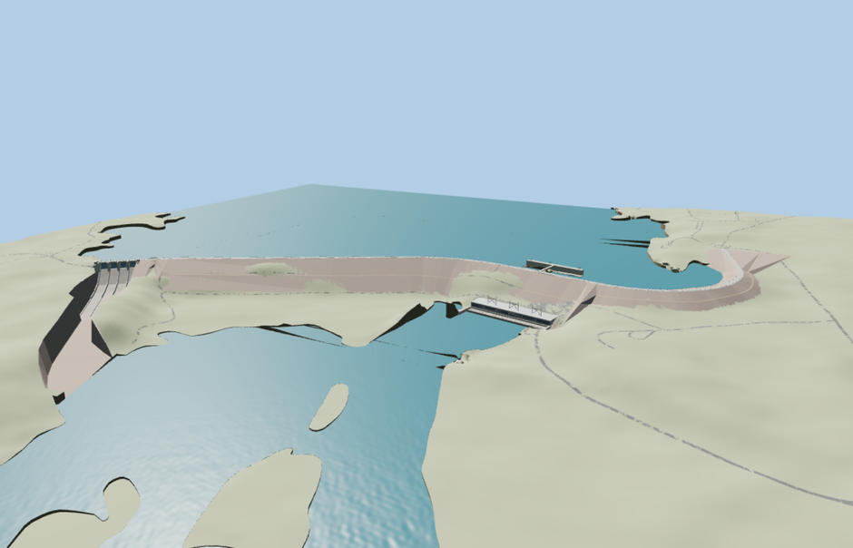

# El Chocón Dam

El Chocón’s curved rockfill crest, four radial gates and six-unit powerhouse follow the retained Limay site. The sloped dry outfall runs from the chutes to the mapped river. The reservoir intake retains its separate footbridge.

The 386 m crest road meets the rendered approaches within 5 cm at both sampled centerlines. The east approach clears the fitted concrete supports. The two parts of the mapped water relation use representative stages of 370.65 m upstream and 315.43 m downstream. The access deck stays below the powerhouse windows.

The viewer retains 73 transportation records in the local fixture. The five covered fragments are replaced by the authored crest and intake paths. A failed download restores the mapped powerhouse and all transportation records. Unload restores ground and land cover and releases the model geometry.

| Detail level | Triangles | Download bytes | Draws |
| --- | ---: | ---: | ---: |
| skyline | 964 | 88,444 | 8 |
| district | 3,220 | 272,388 | 8 |
| street | 7,924 | 650,192 | 8 |
| closeup | 12,244 | 985,004 | 8 |

The first two detail levels total 360,832 bytes. Six GLBs, four focused geometry checks and 190 placement probes passed. 72 current renders were inspected.

The water stages and spillway cross-sections are representative estimates. The outfall banks are faceted to follow the available terrain. A steep shore remains visible beyond the fitted works.

The model shows the gates closed and the spillway dry. Plant interiors and operating flow are outside this exterior scope.

[Mapped site frame](map-frame.json) · [QA evidence](qa.json) · [Water feature settings](../../../../../../earth/hydrology/water-features.json)
