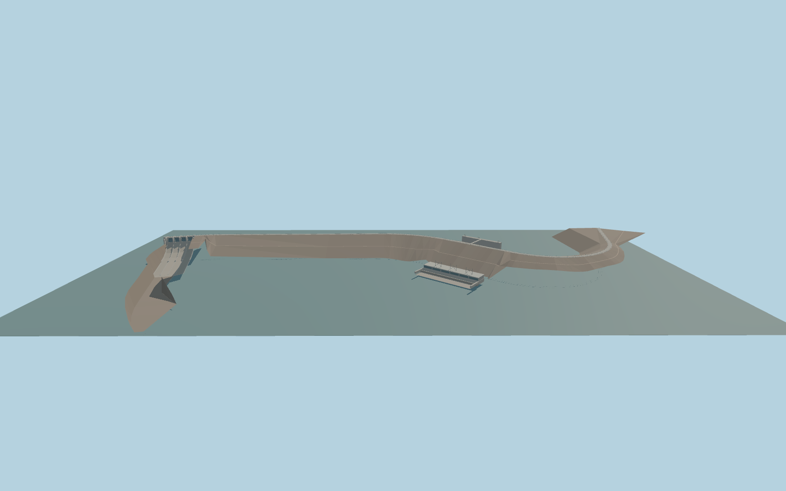

# El Chocón Dam

El Chocón’s curved rockfill embankment, mapped crest road, four-gate spillway, six-unit powerhouse, three roof portals and reservoir intake platform with connecting footbridge.

Rebuild: `node packages/worldgen/scripts/generate-el-chocon-dam.mjs`;append `--check` for exact source bytes. Select import/LOD/placement with `--ids=el_chocon_dam`. Detailed source and four browser tiers are separate ignored GLB outputs.

Fixed 369.7960245 m local datum and 386 m crest. The mapped reservoir and Limay tailwater use representative standard-sample stages of 370.65 m and 315.43 m. The comparison fixture also renders 380.31 m upstream.

The authored road follows the continuous 2103.66 m PMTiles span. Published dam lengths include different abutment and structural extents. The landward tie elevations and slope cross-sections are exterior approximations.

The bounded Earth grades repair isolated raw samples below 280 m around the works and neighboring banks. The retained raw elevations remain available for review. The gates and spillway depict a dry closed state. Approximate fitted dry channel slopes follow the mapped outfall to the Limay.

The six-unit hall and intake follow mapped footprints. Internal turbines, submerged penstocks and the wider switchyard are outside the exterior model.

Original geometry:repository license. Map:© OpenStreetMap contributors,ODbL-1.0;Protomaps. Standard terrain:terrain-grid.json. Ordinary pictures stay local and are not redistributed or used as textures. Current acceptance:qa.json.
