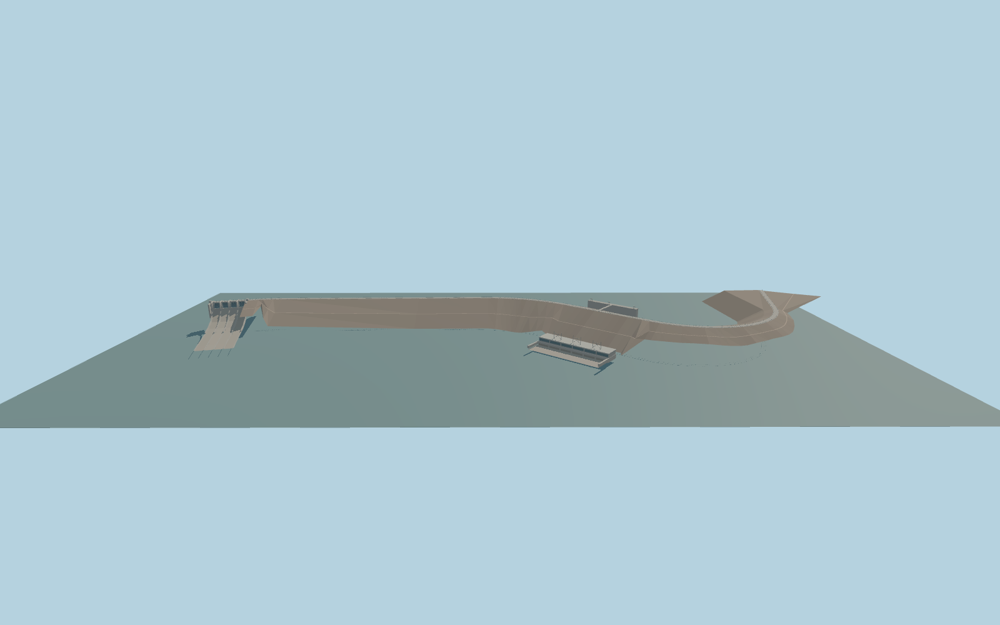

# El Chocón Dam

El Chocón’s curved rockfill embankment, mapped crest road, four-gate spillway, six-unit powerhouse, three roof portals and reservoir intake platform with connecting footbridge.

Rebuild: `node packages/worldgen/scripts/generate-el-chocon-dam.mjs`;append `--check` for exact source bytes. Select import/LOD/placement with `--ids=el_chocon_dam`. Detailed source and four browser tiers are separate ignored GLB outputs.

Fixed 369.7960245 m local datum and 386 m crest. The standard water sampler yields 370.65 m upstream and 315.43 m in the tailwater. The high-water comparison uses the 380.31 m normal maximum.

The authored road follows the continuous 2103.66 m PMTiles span. Published dam lengths include different abutment and structural extents. The landward tie elevations and slope cross-sections are exterior approximations.

The review heightfield repairs 23 isolated samples below 280 m. The raw standard terrain is retained for comparison. Water levels are fixtures, and the spillway is closed and dry.

The six-unit hall and intake follow mapped footprints. Internal turbines, submerged penstocks and the wider switchyard are outside the exterior model.

Original geometry:repository license. Map:© OpenStreetMap contributors,ODbL-1.0;Protomaps. Standard terrain:terrain-grid.json. Ordinary pictures stay local and are not redistributed or used as textures. Current acceptance:qa.json.
