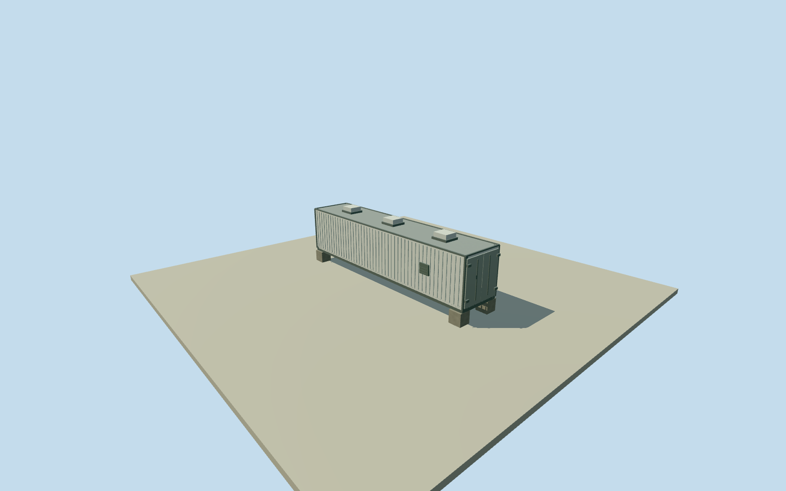

# Auger central laser shelter

Whole post2013 forty-foot central laser housing at its original published site. Complete metal shell/full roof/underframe/four support piers/closed cargo and personnel entries/estimated closed roof covers. Width/height/facing/facade/finish/ground contact estimates explicit. All imagery unused; external CLF equipment separate.

Authoring state: **review-in-qa.json**. Current completion evidence is in [qa.json](qa.json) and the [completion ledger](../../../../qualla-structures/batches/qualla-002.PROGRESS.md).

- [Pierre Auger Observatory](https://qualla.com/pierre-auger-observatory/)

Whole post2013 replacement40ft laser housing. Primary written upgrade establishes40ft length, separate laser room and Raman receiver. Nominal12.192m length;2.438m width/2.591m height assume standard-height ISO container, not surveyed high-cube exclusion. Site point is published CLF UTM19South469378,6095769; exact container centroid offset and heading unverified. Authored nominal rectangle is NOT a native mapped footprint. Heading0 is an explicit visualization estimate; exterior doors, corrugation, closed rooftop service/optical covers, finish and support piers estimated. No photos, figures, plans, diagrams or image-derived descriptions used. Whole housing only; external solar array/weather station/microwave equipment and other observatory structures separate.

Whole40ft replacement housing, all four walls/full closed roof/underfloor/closed cargo doors/service door retained. Standard2.438m width and2.591m height explicitly assumed, with .4m height/width uncertainty. Nominal40ft length12.192m follows written container class; actual modified shell dimensions unsurveyed.

Published original CLF UTM point establishes the site, not the exact2013replacement housing centroid. Estimated15m site-to-container offset uncertainty and180degree heading uncertainty. Original independent256m129x129 source field fixed before floor.2m/pier top.2m/body bottom.35m/roof2.941m. Field/frame/floor/sections never cut, masked, flattened, refetched, reframed or refitted.

Door/vent/corrugation/corner-casting/closed optical-service cover positions, sizes and finish are explicit component estimates with1.5m placement uncertainty. Three closed roof covers symbolize service/vertical/steered/receiver access and do not assert measured optical-port layout or operating mechanisms. No visible laser beam or reconstructed hidden laser/thermal/receiver optics.

This is the whole independent replacement housing, not an exhaustive CLF compound: external solar/battery/weather/microwave equipment and observatory array remain separate. Every photograph/figure/diagram/plan/image-derived description unused; no cleared current exterior photograph. Approximate2018phase, vertical registration and exact grade contact unverified.

Build: `node content/worldgen/source/places/63/63w/auger_central_laser_shelter/models/generate-house.mjs`. Add `--check` to verify exact regeneration. 1776 triangles; 4 materials; no embedded photographs.
