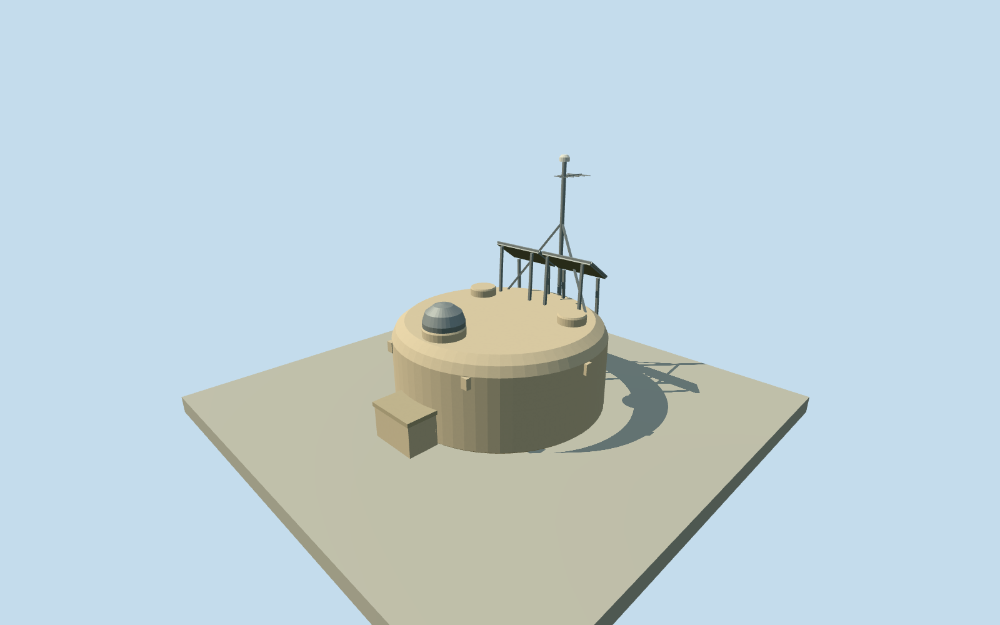

# Pierre Auger water-Cherenkov surface detector

Whole pre-upgrade3.6m beige water-Cherenkov tank, raised hatches/electronics cover, two solar panels, mast/radio/GPS and battery box. Written operator facts and dated numerical station records; no imagery used.

Authoring state: **review-in-qa.json**. Current completion evidence is in [qa.json](qa.json) and the [completion ledger](../../../../qualla-structures/batches/qualla-002.PROGRESS.md).

- [Pierre Auger Observatory](https://qualla.com/pierre-auger-observatory/)

Whole pre-upgrade3.6m rotomolded tank with curved shoulder/top, three raised service hatches, aluminium electronics cover, two solar panels/brackets, mast/radio/GPS, shaded battery box/conduit and lifting/support lugs. Dimensions of small components/pose/orientation estimates. All imagery unused. This equipment asset cannot complete the whole observatory collection.

Written diameter3.6m; exterior nominal1.55m below published1.6m transport maximum.1.2m is water/liner depth, not adopted as outer height. Beige plastic shell, three raised hatches/one aluminium electronics cover, two55Wp panels, bracket/mast/radio/GPS, shaded battery box/conduit and6lifting+4support lugs included. Exact shoulder curvature, component dimensions/count of aerial elements/colors/finish and orientation estimated, component uncertainty.5m/height.6m.

Original reference station101 UTM coordinate retained and converted WGS84/UTM19South. Independent256m129x129field16641heights/2rawtiles, datum1376.3824m/range1372.8427..1378.2142m frozen before floor/sections/geometry. Bottom.1m/bodytop1.65m/masttop4.1m fixed once afterward; no field/floor/section refit or surveyed ground claim. Operator station altitude1403.75m is NOT used to refit provider terrain.

1638 event-active station records on2018-08-31 retained as distinct actual operator IDs/coordinates. First/last event times are not installation/removal dates, nominal1660 census is not fabricated. Not claimed exhaustive physical installation inventory; no per-station equipment variant/orientation survey. Parent remains unfinished until FD houses/HEAT/other intrinsic scope resolved.

One equipment asset with independent geographic instances, no composite array GLB or centroid placement. Pre-upgrade common equipment, no later scintillator/radio upgrade silently added. Original maps and paper figures unused; written facts only.

Four detail levels retain full shell/hatches/electronics cover/two panels/mast/battery box; curvature, solar cell grooves, aerial rods/lugs simplify at distance. Illustrative assembly orientation estimated, no functional detector/RFI behavior or internal water/PMT electronics simulation.

Build: `node content/worldgen/source/places/63/63w/auger_surface_detector/models/generate-house.mjs`. Add `--check` to verify exact regeneration. 2304 triangles; 3 materials; no embedded photographs.
