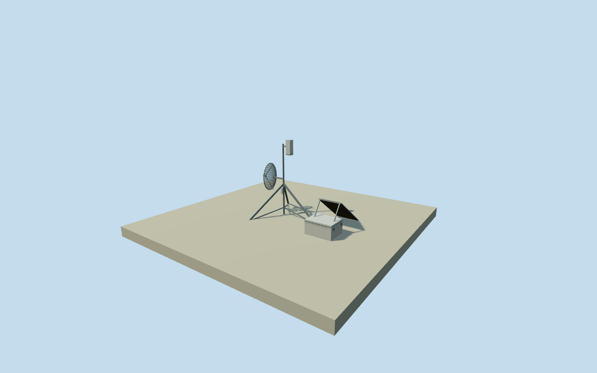

# Los Leones electric field station

Whole independent armadiLLo electric-field instrument assembly: sensor, tripod and anchoring, solar rack, closed electronics box, grounding and grid dish radio. Existing/new site fence and other observatory equipment remain separate; whole observatory unfinished. Original table4.2 rounded point and north/east frame fixed before independent source field or sections. Sensor face2m, box0.8x0.6x0.410m are written measurements; other architectural shape, finish and placements are explicit schematic estimates. Every source image/figure/diagram/plan unused. Original schematic estimates: .05m mast diameter,2.30m mast top,1.15m tripod leg spread, brackets, vertical orientation of the .152x.152x.432m nominal sensor envelope, .84x.60m radio-grid dish,1.2x.67m solar panel and its slope/offset, joinery, cables, colors and all minor fittings. Sensor face remains2m over the original point datum; no lightning rod or guy wires. The exact component offsets, yaw, ground registration and graded patch are unverified. Published latitude/longitude rounded to five decimals; datum not separately stated;10m horizontal and180degree orientation uncertainty are nominal estimates. Whole independent instrument assembly only. Existing BATATA fencing/new15m field-station fences remain separate because exact boundaries are unprovided. Other detectors, CRS, AERAWS, receiving-tower antenna and entire observatory are not represented by this model. Represented November2023 installation after documented battery servicing. Every source photograph, figure, diagram, plan and image-derived description unused. Original source field fixed before these floor/section estimates; no grade cutout/flattening/mask/refit.

Authoring state: **review-in-qa.json**. Current completion evidence is in [qa.json](qa.json) and the [completion ledger](../../../../qualla-structures/batches/qualla-002.PROGRESS.md).

- [Pierre Auger Observatory](https://qualla.com/pierre-auger-observatory/)

Whole independent armadiLLo electric-field instrument assembly: sensor, tripod and anchoring, solar rack, closed electronics box, grounding and grid dish radio. Existing/new site fence and other observatory equipment remain separate; whole observatory unfinished. Original table4.2 rounded point and north/east frame fixed before independent source field or sections. Sensor face2m, box0.8x0.6x0.410m are written measurements; other architectural shape, finish and placements are explicit schematic estimates. Every source image/figure/diagram/plan unused.

Original schematic estimates: .05m mast diameter,2.30m mast top,1.15m tripod leg spread, brackets, vertical orientation of the .152x.152x.432m nominal sensor envelope, .84x.60m radio-grid dish,1.2x.67m solar panel and its slope/offset, joinery, cables, colors and all minor fittings. Sensor face remains2m over the original point datum; no lightning rod or guy wires.

The exact component offsets, yaw, ground registration and graded patch are unverified. Published latitude/longitude rounded to five decimals; datum not separately stated;10m horizontal and180degree orientation uncertainty are nominal estimates.

Whole independent instrument assembly only. Existing BATATA fencing/new15m field-station fences remain separate because exact boundaries are unprovided. Other detectors, CRS, AERAWS, receiving-tower antenna and entire observatory are not represented by this model.

Represented November2023 installation after documented battery servicing. Every source photograph, figure, diagram, plan and image-derived description unused. Original source field fixed before these floor/section estimates; no grade cutout/flattening/mask/refit.

Build: `node content/worldgen/source/places/63/63w/los_leones_electric_field_station/models/generate-house.mjs`. Add `--check` to verify exact regeneration. 4600 triangles; 4 materials; no embedded photographs.
