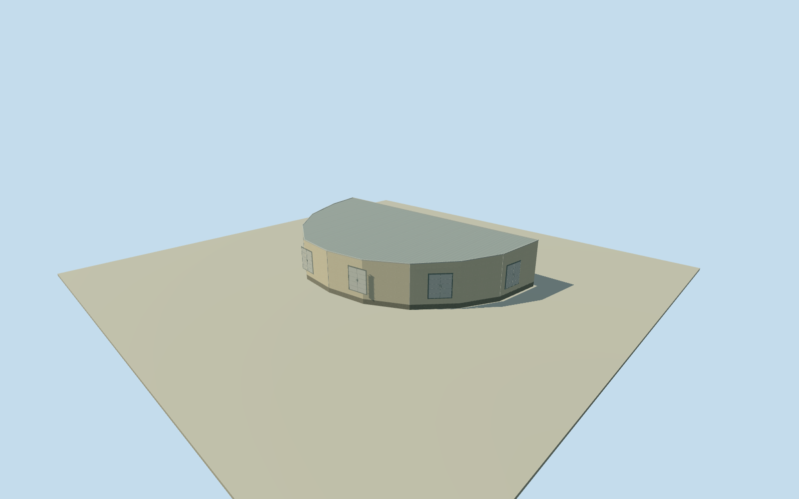

# Los Leones fluorescence building

Whole original named eleven-corner semicircular fluorescence building, allwalls/fullroof/base and six daytime closed telescope bays/rearentry. Native numerical outline and written operator architecture only; roof/height/facade/finish estimated.

Authoring state: **review-in-qa.json**. Current completion evidence is in [qa.json](qa.json) and the [completion ledger](../../../../qualla-structures/batches/qualla-002.PROGRESS.md).

- [Pierre Auger Observatory](https://qualla.com/pierre-auger-observatory/)

Whole independent Los Leones fluorescence building/all11nativecorners/full outer walls/complete roof/base/six telescope stations with closed paired shutters and rear service entries. Written operator facts only. Height/roof/casing/shutter/door/finish counts and dimensions are estimates. Adjacent communication tower/atmospheric instruments/HEAT are separate scope, not merged into this building. Parent observatory remains unfinished.

Whole original11corner semicircular outline/all10curved facade segments/long backwall/full roof retained. Native outline from2011; retrospective2018phase approximate. Six telescopes per building/180degree total view/1.1m optical diaphragm radius from operator. Daytime shutters represented CLOSED, no missing opening or hidden functional interior claim. Roof shape/height, shutter centres/bayfacade/doors/vents/panel joints/finish/colors are estimates,2m height and2m component uncertainty.

Independent256m129x129sourcefield/16641heights/2rawtiles; datum1390.3242m/absolute range1373.28..1392.1638m. Native long backwall midpoint contact fixed before field. Floor.2m/foundation-.6m/front roof5.4m/back roof6.2m chosen once afterward, no field/floor/section reframe/refetch/masking/flatten/refit. Coarse hilltop grade may expose or bury lower elevations; not surveyed vertical registration.

All six telescope bays included with paired closed steel shutters/frames; whole independent outer envelope and full slightly sloped roof with edge coping. Exact optical interior/individual mirrors unseen and excluded. Communication tower, LIDAR/other atmospheric equipment, HEAT, and nearby independent shelters need separate physical scope; not merged into this asset.

Qualla first27families/0conflicts, all images unused. Questionable PD-self tank photo unused. Written2015operator architecture facts/native named OSM numerical footprint only. ODbL attribution preserved. No photographic tracing/rightsrepair/imagery approval claimed.

Four detail levels retain whole11corner building/all walls/full roof/base/six closed telescope shutters and rear entry. Coping/panel seams/hinges/door hardware reduce at distance. Whole parent Pierre Auger Observatory remains incomplete.

Build: `node content/worldgen/source/places/63/63w/los_leones_fluorescence_building/models/generate-house.mjs`. Add `--check` to verify exact regeneration. 947 triangles; 4 materials; no embedded photographs.
