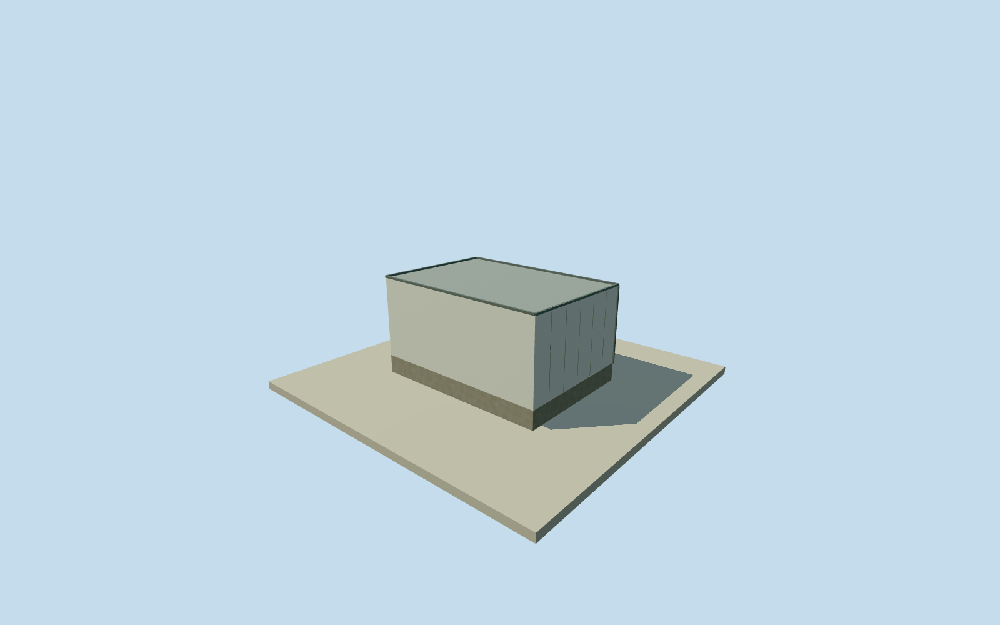

# Los Leones LIDAR building

Whole independent original four-corner LIDAR building/all walls/complete roof/base, closed service entry/exterior ventilation. Roof/height/facade/finish estimates; hidden instrument optics unasserted. Written operator role facts and numerical original footprint only; every image unused.

Authoring state: **review-in-qa.json**. Current completion evidence is in [qa.json](qa.json) and the [completion ledger](../../../../qualla-structures/batches/qualla-002.PROGRESS.md).

- [Pierre Auger Observatory](https://qualla.com/pierre-auger-observatory/)

Whole independent Los Leones LIDAR building/all4originalcorners/allwalls/fullroof/base and closed exterior service entry/vents. Operator text establishes elastic lidar/steerable laser/three80cm and one20cm mirrors, not exact enclosure roof/height/facade. Interior laser/mirrors not exterior-surveyed; no guessed operating mechanism presented as fact. Exact sections/finish are estimates; all imagery unused, whole observatory remains unfinished.

Original entire four-corner mapped building/all walls/full roof/base retained. One-storey closed instrument shelter, shallow metal roof, closed entry, ventilation and service box are exterior estimates, height/component uncertainty1.5m. No roof-opening design, operating external telescope, mirror arrangement, laser beam or hidden interior asserted. Three80cm/one20cm mirrors are written instrument facts, not measured building dimensions.

Original independent256m129x129field/16641heights/2rawtiles/datum1389.9454m/range1376.4255..1392.1655m fixed before floor.2m/foundation-.6m/roof3.1..3.2m. No field/frame/floor/roof section cut/mask/flatten/refetch/reframe/refit. Native2011outline used for approximate2018phase; grade/threshold unsurveyed.

Qualla first27families/0conflicts; all imagery unused, questionable PD-self tank source skipped without questions or repair. Native OSM numerical outline/ODbL attribution and written operator facts only. No current exterior photograph or exact finish/roof census claimed.

Whole independent building at actual native anchor; adjacent Los Leones mainFD/tower and other observatory structures separate. FourLODs retain full body/roof/entry/base, finer panel joints/coping/ventilation simplify. Whole observatory remains unfinished.

Build: `node content/worldgen/source/places/63/63w/los_leones_lidar_building/models/generate-house.mjs`. Add `--check` to verify exact regeneration. 264 triangles; 4 materials; no embedded photographs.
