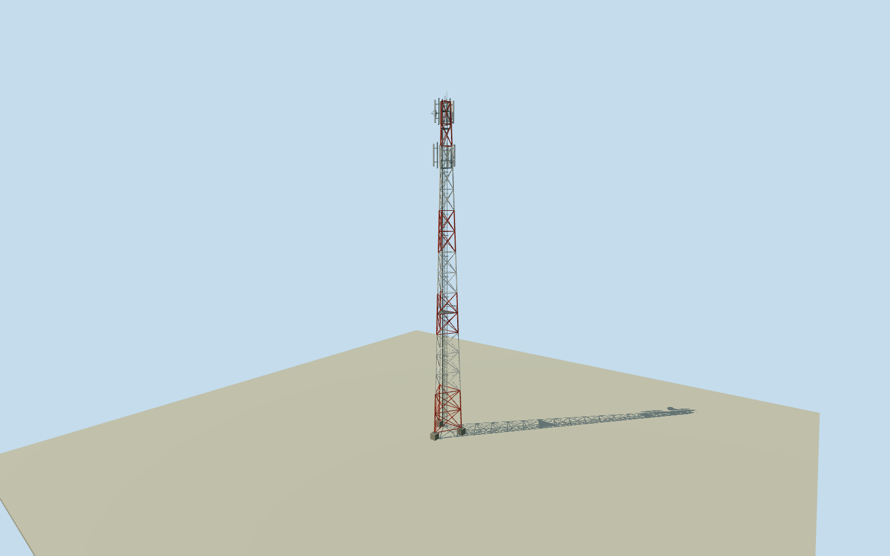

# Los Morados communications tower

Whole independent original communications tower: three-legged steel lattice, concrete footings, ladders/platforms and complete original numerical antenna set. Original height/type/true bearings/dish diameters retained; exact lattice/brackets/platform shapes and phase carryover explicitly estimated. Every image unused.

Authoring state: **review-in-qa.json**. Current completion evidence is in [qa.json](qa.json) and the [completion ledger](../../../../qualla-structures/batches/qualla-002.PROGRESS.md).

- [Pierre Auger Observatory](https://qualla.com/pierre-auger-observatory/)

Whole independent communications tower with three support legs/all-height lattice/antenna set/ladder/platforms/concrete footings. Five-tower network confirmed in2015 operator paper; antenna layout from2005 technical inventory approximates2018 phase, unchanged hardware not independently established. Exact base width/taper/member sizes/platform shape/brackets/ground contact estimated. All photographs/figures/diagrams/plans unused. Ancillary communications shelter is a separate physical structure, not silently claimed included; whole observatory unfinished.

Actual July2005 antenna inventory is39antennas across5towers. All exact centre heights/true bearings/dish diameters retained. Panel form uses manufacturer CTSG-09015-0D2.575x.267x.132m grayUVPVC dimensions; exact variant/site mounting offsets not independently confirmed. Old specification nominal3m panel envelope and2.5m early model are not silently treated as identical.

Published tower height retained; exact footing tops/base width/taper/crossmember spacing/platform shape/lattice yaw and bracket offsets estimated, uncertainty1.5m for unestablished components.

Triangular three-leg self-support steel structure and protected safety/cable ladder/platforms follow written tower specifications; exact member dimensions and taper are estimates. Red-white striping follows written Coihueco/LosMorados/LomaAmarilla instructions; applied to LosLeones/campus as explicit finish estimate. No hidden foundation steel/interior telecommunications gear or dynamic lights claimed.

Independent256m129x129field/16641heights/1rawtiles/datum1393.5895m frozen before floor.3m/footing-.6..+.3m/main sections. No field/frame/floor/main-section cut/mask/flatten/refetch/reframe/refit; grade/contact unsurveyed.

All Qualla imagery first screened27families/0conflicts; every photograph/figure/diagram/plan unused, questionable source skipped. Original written engineering facts and numerical table coordinates only. Separate ancillary shelter/cablebridge footprints remain a separate task; this asset is whole tower, not whole observatory.

Build: `node content/worldgen/source/places/63/63w/los_morados_communications_tower/models/generate-house.mjs`. Add `--check` to verify exact regeneration. 5592 triangles; 4 materials; no embedded photographs.
