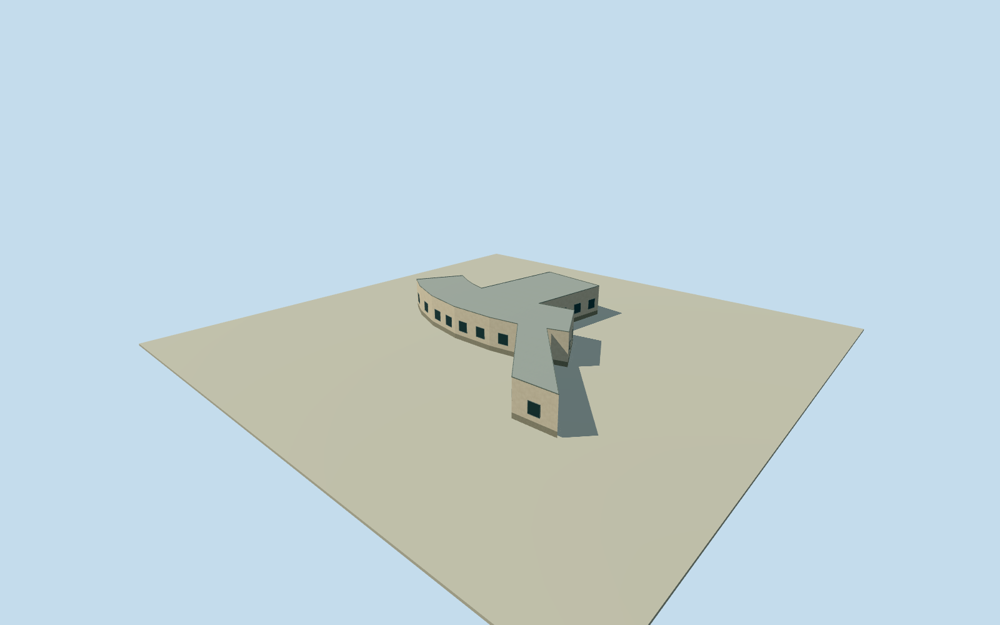

# Malargüe campus main building

Whole original independent campus building/all original outline corners, full exterior walls/roof/base and estimated closed entries/facade windows. Written role/address facts and numerical outline only; exact vertical sections, roof and finish estimated. All photographs/figures/plans and image-derived descriptions unused.

Authoring state: **review-in-qa.json**. Current completion evidence is in [qa.json](qa.json) and the [completion ledger](../../../../qualla-structures/batches/qualla-002.PROGRESS.md).

- [Pierre Auger Observatory](https://qualla.com/pierre-auger-observatory/)

Whole independent native building/all original corners/full exterior body/roof/base and estimated closed entrances/windows. Main includes curved multi-corner office outline, north wing and narrow connecting projection; assembly separate whole large rear building. Exact height/roof profile/vertical section/finish/facade openings unestablished and estimated; original2011map geometry approximates2018phase. Every photograph/diagram/plan/image-derived description unused; whole observatory unfinished.

Entire original mapped building/all exterior walls/full roof/base retained. Vertical dimensions/roof profile/window-door arrangement/material colours are unsurveyed medium-fi estimates, height/component uncertainty2.5m. Main office roof estimated4.5m; assembly roof estimated5.5m eave/7.8m ridge. No interior floor plan or detailed photographic reconstruction claimed.

Independent256m129x129field/16641heights/1rawtiles/datum1415.3101m fixed before floor.25m/foundation-.6..+.25m/sections. Original source grade/contact approximate. No field/frame/floor/mainsection cut/mask/flatten/refetch/reframe/refit.

Published Qualla corpus first27families/0conflicts, no qualifying architectural public-domain photograph adopted. All photographs/figures/diagrams/plans/image-derived web descriptions unused; only written primary role/address facts and original numerical footprint. Roof/façade not reverse-engineered from unapproved photography.

Native exact named address304AvSanMartinNorte identifies main office/control/visitor-centre building; all19nativeoutlinecorners, curved office chain/north wing/narrow connecting projection retained. Exact external sections and finish unestablished.

Parent observatory unfinished; adjacent campus tower/main/assembly/utility structures separate, no standalone wing used as whole observatory.

Build: `node content/worldgen/source/places/63/63w/malargue_campus_main_building/models/generate-house.mjs`. Add `--check` to verify exact regeneration. 1998 triangles; 4 materials; no embedded photographs.
